# Affiliate Platform 新一代生产级进阶升级与功能落地实施规范
# (Next-Generation Advanced Production Upgrade & Implementation Specification)

> **版本**：v3.0.0 商业进阶升级落地版  
> **状态**：全面实施与功能落地  
> **适用范围**：`platform-affiliate`, `platform-dsp`, `platform-creative`, `platform-reporting`, `platform-common`, `platform-infrastructure`  
> **核心原则**：不留空壳占位，严谨闭环数学算法，覆盖全套异常与并发边界，100% 编译与单元测试覆盖。

---

## 一、 系统升级背景与进阶设计目标

在前期版本中，系统已构建了涵盖 DSP、SSP、ADX、网盟点击追踪与转化、反作弊、多触点归因与长视频工作台的完整模块化单体底座。为支撑全球化十亿级事件吞吐、应对无 Cookie 时代隐私挑战，并实现 AI 驱动的自主营销与动态变现最优化，系统启动新一代核心能力进阶开发：

1. **网盟营销智能分流进阶 (LinUCB Contextual Bandit)**：
   解决新 Offer 冷启动与经验主义静态 EPC 分流瓶颈，引入带岭回归（Ridge Regularization）的 **LinUCB** 与 **Thompson Sampling** 上下文多臂老虎机，实现探索 (Exploration) 与利用 (Exploitation) 的动态平衡。
2. **DSP 深度预估与动态出价进阶 (Deep CTR/CVR Factorization Machine)**：
   突破传统简单乘法与经验阻尼，引入向量化因子分解机（Factorization Machine / Deep Embedding Logits）预估点击率（pCTR）与转化率（pCVR），与 Logistic Bid Shading 无缝融合，达成期望剩余价值最优出价。
3. **全球移动端现代隐私归因进阶 (Apple SKAdNetwork 4.0 / AdAttributionKit)**：
   面向 iOS 16.1+ 与 iOS 17+ 隐私政策，实现 3 阶段回传窗口、粗细粒度（Coarse / Fine-grained）转化值解码、4 位层次化 Source Identifier 映射与加密防重防重放。
4. **AI 营销创意自治闭环 Agent (Creative Autonomous Agent & Self-Refine)**：
   联动 7 日大盘质量打标，自动识别黑洞/衰退素材，通过大模型 Prompt 模板与痛点洞察执行分镜与剧本 Self-Refine，自动重构剪映 4 轨道工程并调度小额学习期 AB 实验。
5. **高性能 OLAP 多维报表加速与双引擎路由 (Dual-Engine OLAP Reporting)**：
   面向 Sub-ID（`sub1`~`sub5`）多维分析与海量日志下钻，建立 OLAP 内存微批/列式聚合加速引擎与双引擎透明路由，保障高并发写入与亚秒级报表检索。

---

## 二、 核心进阶功能详细架构与算法规范

```mermaid
flowchart TD
    subgraph Affiliate_Bandit ["1. TDS LinUCB 智能分流 (platform-affiliate)"]
        User_Req["推广点击上下文 (Country, Device, Hour, Sub-ID)"] --> Feat_Ext["FeatureExtractor 实时向量化 (d维特征)"]
        Feat_Ext --> Ridge_Calc["LinUCB: a* = argmax (x' theta_a + alpha * sqrt(x' A_a^-1 x))"]
        Ridge_Calc --> Fallback_TS["冷启动分支: Thompson Sampling Beta 分布采样"]
        Ridge_Calc --> Redirect["302 跳转最优 Offer"]
        Conversion_Feed["转化佣金反馈"] --> Online_Update["增量在线更新 A_a += x x', b_a += r x"]
    end

    subgraph DSP_Deep_Bidding ["2. 深度 pCTR/pCVR 智能出价 (platform-dsp)"]
        RTB_Req["RTB TrafficContext"] --> Dense_Sparse["稀疏与密集特征交叉 Embedding"]
        Dense_Sparse --> FM_Engine["DeepCtrCvrInferenceEngine (FM 二阶特征交叉 + Sigmoid)"]
        FM_Engine --> Optimal_Formula["Optimal Bid = Target_CPA * pCVR * pCTR * ShadingDiscount"]
        Optimal_Formula --> Guardrails["底价护栏与出价钳位 [Floor, MaxBid]"]
    end

    subgraph SKAN_Privacy ["3. Apple SKAN 4.0 归因中枢 (platform-affiliate)"]
        Skan_Postback["Apple S2S 回传 payload (4位 source-id, postback-sequence-index)"]
        Skan_Postback --> Decode_CV["CV 解码器 (Fine 0-63 vs Coarse low/medium/high)"]
        Decode_CV --> Time_Align["Window 1/2/3 时间对齐与防重放校验"]
        Time_Align --> Invoice_Merge["无缝并入渠道账期结算与多维报表"]
    end

    subgraph Creative_Agent ["4. 营销创意自治 Agent (platform-creative)"]
        Bench_Event["7日大盘质量打标 (BLACK_HOLE / LONG_TAIL)"] --> Trigger_Agent["CreativeAutonomousAgentService 启动诊断"]
        Trigger_Agent --> Diagnosis["诊断漏斗流失: 前3秒 Hook 疲劳 / CTA 转化低"]
        Diagnosis --> Prompt_Refine["Prompt Self-Refine 重新生成分镜与台词"]
        Prompt_Refine --> Rebuild_Studio["重构分镜资产与 CapCut 4 轨道草稿"]
        Rebuild_Studio --> Auto_AB["自动提交建广与 DSP 小额学习期 AB 竞价"]
    end

    subgraph Dual_OLAP ["5. 双引擎 OLAP 报表加速 (platform-reporting)"]
        Query_Req["多维报表查询请求 (Sub1..Sub5, 转化漏斗, 任意时段)"]
        Query_Req --> Route_Decision{"数据跨度与维度基数判定"}
        Route_Decision -->|单日精确/小范围| PG_Query["PostgreSQL 关系型主库"]
        Route_Decision -->|大跨度/多维聚合/下钻| OLAP_Engine["OlapReportingEngine 列式加速缓存"]
    end
```

---

## 三、 各模块详细设计与边界规范

### 1. TDS LinUCB 上下文多臂老虎机 (`platform-affiliate`)
*   **数学模型**：
    每个 Offer（臂 $a$）维护 $d$ 维特征协方差逆矩阵 $A_a^{-1}$（初始化为 $\frac{1}{\lambda} I_d$，岭回归系数 $\lambda = 1.0$）和收益向量 $b_a$。
    参数估计：$\hat{\theta}_a = A_a^{-1} b_a$。
    置信上限（Upper Confidence Bound）：
    $$\text{UCB}_a = x^T \hat{\theta}_a + \alpha \sqrt{x^T A_a^{-1} x}$$
    利用探索超参数 $\alpha$ 调节探索力度（默认 $\alpha = 0.5$）。
*   **冷启动保护**：
    样本量 $< 10$ 时，平滑切换至 **Thompson Sampling**（从 $\text{Beta}(\alpha_0 + \text{wins}, \beta_0 + \text{losses})$ 采样），避免逆矩阵奇异性。
*   **并发与边界控制**：
    - 采用线程安全容器维护各 Offer 状态；
    - 使用 Sherman-Morrison 公式执行秩 1 增量逆矩阵更新，将时间复杂度从 $O(d^3)$ 降至 $O(d^2)$；
    - 收益截断：奖励值 $r \in [0.0, 10.0]$ 进行归一化钳位，防止巨额偶发转化拉偏权重。

### 2. DSP 深度 pCTR/pCVR 预估引擎 (`platform-dsp`)
*   **算法结构**：
    采用工业级 **Factorization Machine (FM)** 向量化二阶特征交叉：
    $$\hat{y}(x) = w_0 + \sum_{i=1}^n w_i x_i + \sum_{i=1}^n \sum_{j=i+1}^n \langle v_i, v_j \rangle x_i x_j$$
    其中二阶交叉项优化为：
    $$\frac{1}{2} \sum_{f=1}^k \left[ \left( \sum_{i=1}^n v_{i,f} x_i \right)^2 - \sum_{i=1}^n v_{i,f}^2 x_i^2 \right]$$
    实现 $O(k \cdot n)$ 线性计算复杂度，满足 RTB $< 0.1\text{ms}$ 热路径硬性 SLA。
*   **异常与边界护栏**：
    - 未见特征（Cold-start domain / slot）平滑退化至基线全局先验；
    - 预估概率限制在 $[0.0001, 0.9500]$，防止除以零或离群值击穿出价；
    - 最优出价自动受制于 `slot.floorPrice` 硬底价和 `campaign.maxBid` 硬上限。

### 3. Apple SKAdNetwork 4.0 归因解析引擎 (`platform-affiliate`)
*   **层级结构**：
    - **Source Identifier**：4 位整数结构（第 1-2 位：Campaign ID；第 3 位：Coarse Geo/Placement；第 4 位：Creative Variant）；
    - **Conversion Value (CV)**：
      * Window 1 (0-2天)：细粒度 (0-63) 或 粗粒度 (`low`, `medium`, `high`)；
      * Window 2 (3-7天) & Window 3 (8-35天)：仅粗粒度与 null。
*   **边界与幂等**：
    - 严格依据 `ad-network-id`、`transaction-id` 与 `postback-sequence-index` 建立唯一幂等去重键；
    - 缺少转化金额时基于粗粒度值推导估计公允价值（`low`=\$2, `medium`=\$10, `high`=\$30），确保财务核销可审计。

### 4. 营销创意自治闭环 Agent (`platform-creative`)
*   **闭环联动拓扑**：
    - 实时监听 `MaterialQualityBenchmarkService` 触发的打标事件；
    - 针对评分低于阈值（如衰退、黑洞）的素材，启动自治诊断流水线：
      1. 提取受众跳出热点（Hook 留存率、中段完播率、CTA 点击率）；
      2. 针对性重写前 3 秒钩子台词与字幕花字；
      3. 自动生成新 `StudioProjectEntity`，调度多模型引擎重新渲染画面；
      4. 自动导出剪映官方草稿 `draft_content.json`；
      5. 在广告管理端注入探索期出价规则（初始小额预算 AB 测试）。
*   **防失控保护**：
    - 单素材 24 小时内自治优化次数上限限制（最大 3 次），防止死循环消耗算力；
    - 严苛的算力预占与预算阈值校验。

### 5. 双引擎 OLAP 多维报表加速 (`platform-reporting`)
*   **透明查询路由机制**：
    - 单日精确查询与事务级操作直达 PostgreSQL 主库；
    - 跨时间段（$\ge 3$ 天）、高基数下钻（`sub1`~`sub5` 联合分组）、留存 Cohort 计算自动切换至高效内存增量预聚合 / 列式加速层；
    - 提供 ClickHouse 原生 DDL 规范与内存轻量级列式聚合双重保障，支持无缝横向扩展。

### 6. 企业级多模型网关与全局认知计算中枢 (`platform-ai`)
*   **多租户动态模型配置与主备故障转移**：
    - 纳管 OpenAI、DeepSeek、Claude、Qwen、Ollama、私有化 vLLM 模型；
    - 动态配置 API Key、Base URL、超参（Temperature、Max Tokens、Top P、超时时间）；
    - 密钥敏感脱敏展示与存储，支持单租户优先级排序与故障转移（Failover）；
*   **结构化参数 Prompt 模板管理引擎**：
    - 支持运行时 `{{variable}}` 参数渲染；
    - 预置素材自省诊断、营销文案扩展、反作弊取证研判、DSP 出价顾问、高管经营分析 5 大数字营销专属模板；
*   **弹性双协议客户端与语义回退保底机**：
    - 标准化兼容 OpenAI 与 Claude 双协议通信；
    - 外部 API 离线/欠费时无缝降级为高拟真领域语义推理机，防止下游调用链阻塞；
*   **全系统认知中枢赋能**：
    - `platform-creative`：短视频素材跳出率深度归因与自省重构、爆款文案裂变；
    - `platform-dsp`：结合 FM 因子分解机点击率/转化率预测的出价优化与策略顾问；
    - `platform-affiliate`：短 TTIC、机房代理、指纹聚集等作弊特征深度取证与 Sub-ID 治理；
    - `platform-reporting`：经营大盘多维指标深度解读与高管商业决策简报生成。

---

## 四、 实施计划与交付验收指标

1. **代码落地标准**：
   - 所有类必须具备完整 Javadoc 与异常安全防护；
   - 杜绝 `// TODO`、假数据、空实现与未使用的临时变量；
   - 边界防御包括并发竞争、零除防御、负值钳位、空指针防御及格式容错。
2. **测试与质量门禁**：
   - 编写完整的单元测试覆盖所有核心算法；
   - 保证全工程 20 个 Maven 模块回归测试 **100% BUILD SUCCESS**。
