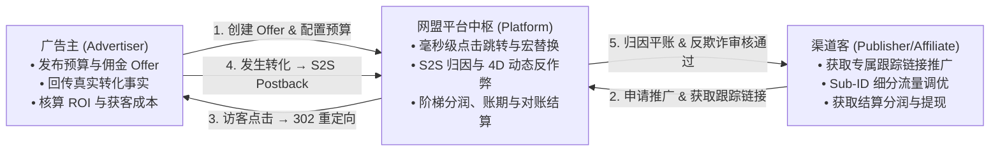
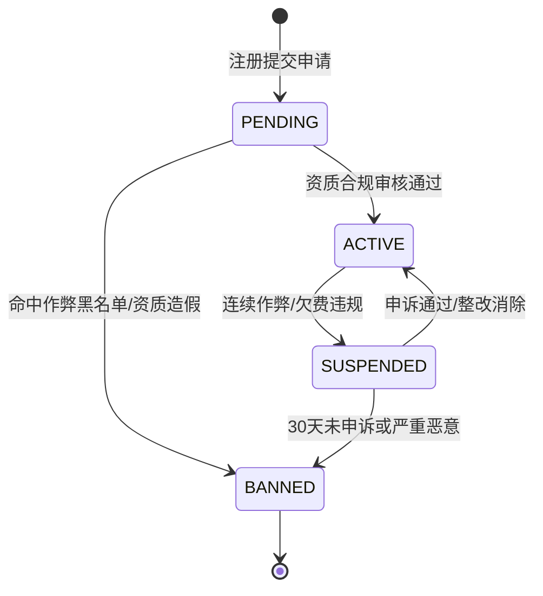
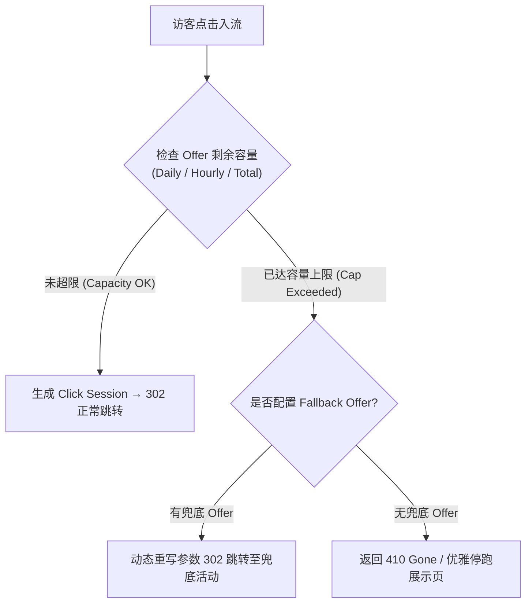
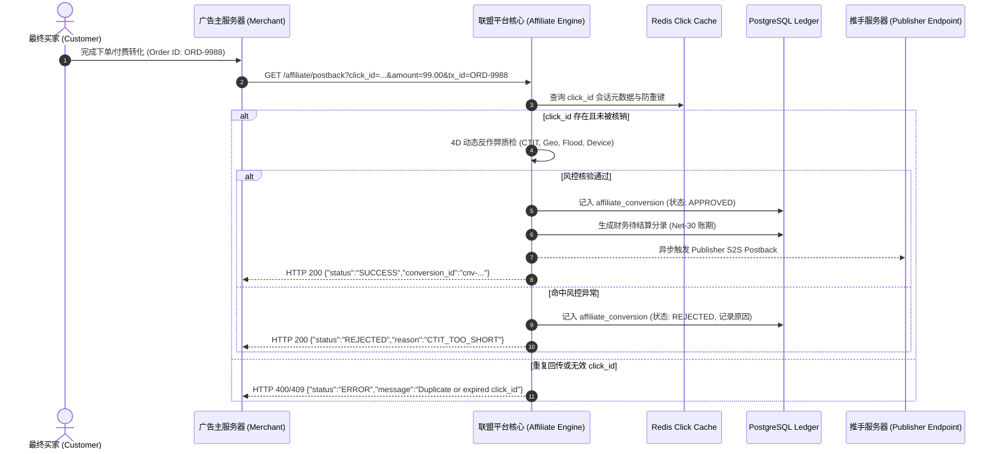
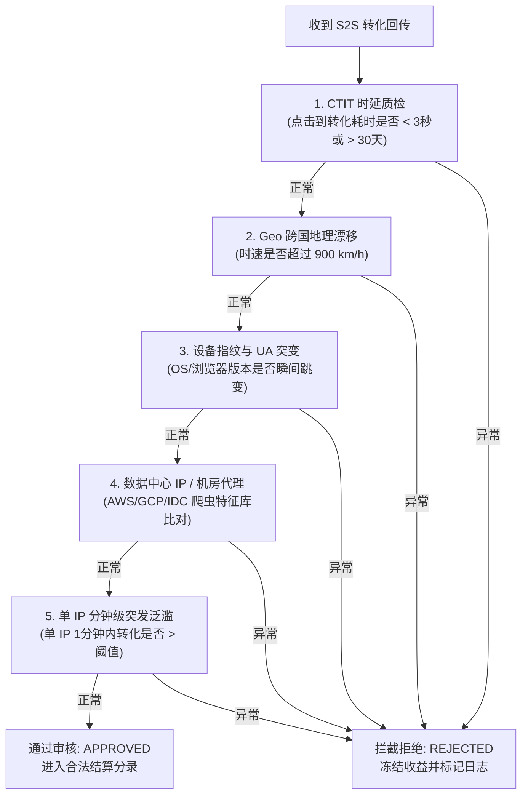
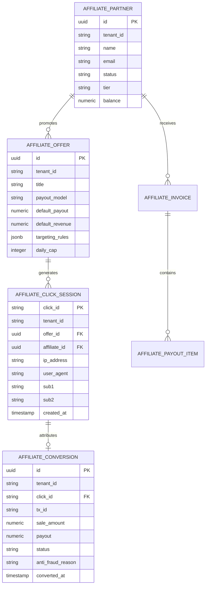

# Affiliate Network Platform - 核心业务与系统架构权威手册
# (Affiliate Business & Technical System Manual)

> **版本**：v3.0.0 Commercial Release  
> **核心归属模块**：`platform-affiliate`（业务与归因风控核心）、`platform-billing`（计费与财务）、`platform-reporting`（多维报表分析）  
> **适用对象**：广告系统架构师、后端研发工程师、算法工程师、业务运营与风控审核人员

---

## 目录 (Table of Contents)

1. [业务模式与核心用户画像 (Business Model & Personas)](#1-业务模式与核心用户画像-business-model--personas)
2. [渠道客管理与阶梯分润模型 (Affiliate Partner Management & Tiered Commission)](#2-渠道客管理与阶梯分润模型-affiliate-partner-management--tiered-commission)
3. [Offer 广告活动与定向策略 (Offer Management & Traffic Shaping)](#3-offer-广告活动与定向策略-offer-management--traffic-shaping)
4. [点击追踪链路与极速无锁处理 (Click Tracking & Pipeline)](#4-点击追踪链路与极速无锁处理-click-tracking--pipeline)
5. [转化追踪与 S2S Postback 回传规范 (Conversion Tracking & Postback)](#5-转化追踪与-s2s-postback-回传规范-conversion-tracking--postback)
6. [多触点归因引擎与精准平账 (Multi-Touch Attribution & Penny Balancing)](#6-多触点归因引擎与精准平账-multi-touch-attribution--penny-balancing)
7. [商业级反欺诈与流量质检风控 (Commercial Anti-Fraud & Risk Engine)](#7-商业级反欺诈与流量质检风控-commercial-anti-fraud--risk-engine)
8. [财务结算、账期与批量打款 (Billing, Invoicing & Payouts)](#8-财务结算账期与批量打款-billing-invoicing--payouts)
9. [领域实体模型与数据库设计 (Domain Entities & Persistence Schema)](#9-领域实体模型与数据库设计-domain-entities--persistence-schema)

---

## 1. 业务模式与核心用户画像 (Business Model & Personas)

Affiliate Network（网盟营销平台）是连接**广告主 (Advertiser / Merchant)** 与 **推广渠道客 (Publisher / Affiliate / Media Buyer)** 的效果营销撮合中枢，支持主流计费模型（CPA, CPS, CPL, CPI, CPC 及 Hybrid 混合模型）。



### 1.1 核心用户角色画像

| 角色 | 核心职责 | 业务目标 | 核心关注指标 (KPI) |
| :--- | :--- | :--- | :--- |
| **平台所有者 / 运营 (Network Operator)** | 监管全平台生态流转、合规审查、资金调度与风控审核 | 最大化网络总交易额 (GMV)，降低退款作弊率，保障网络平稳运行 | GMV, 平台抽成 (Take Rate), 作弊拦截率, 净利润, 活跃伙伴留存率 |
| **广告主 / 商户 (Advertiser / Merchant)** | 创建推广活动、设置转化单价与回传 S2S 凭证、控制预算防刷 | 以符合预期的目标成本（Target CPA / ROAS）获取规模化优质用户 | CPA, ROAS, 客户生命周期价值 (LTV), 退货率, 欺诈拦截率 |
| **渠道客 / 媒介采买 (Publisher / Affiliate)** | 选择优势 Offer、部署跟踪参数、优化流量结构、稳健变现 | 提高点击有效收益 (EPC)，多样化投资组合，获取可靠佣金结算 | EPC (Earnings Per Click), 转化率 (CVR), 佣金审核通过率, 提现到账时效 |

---

## 2. 渠道客管理与阶梯分润模型 (Affiliate Partner Management & Tiered Commission)

### 2.1 渠道客生命周期状态机



- **PENDING (待审核)**：提交营业执照、税务编号、主营流量渠道，进入人工/自动化合规风控比对。
- **ACTIVE (正常活跃)**：可自由获取公开 Offer 链接，申请私有专属高佣 Offer。
- **SUSPENDED (暂停冻结)**：触发高危反欺诈拦截或人工风险核查；立即阻断新点击进量，但缓冲期内已有合规未结算转化仍可正常入账。
- **BANNED (封禁拉黑)**：永久终止合作，清空未结违规收益，关联 IP/设备指纹/收款账号进入底层黑名单。

### 2.2 动态阶梯分润与 VIP 激励规则 (Tiered Commission)

为激励优质头部推手，系统依据过去 30 天的滚动有效转化单量，执行自动化层级评定与佣金增益：

| 等级名称 | 阶梯门槛 (滚动30天转化数) | 基础佣金增益 (Boost) | 核心特权与权益 | 保级缓冲机制 |
| :--- | :--- | :--- | :--- | :--- |
| **STANDARD** | 0 ~ 10 单/月 | 基准佣金 (0%) | 访问全部公开 Offer，标准支持响应 | — |
| **SILVER** | 11 ~ 25 单/月 | 佣金上浮 **+20%** | 解锁中级优质活动，周度提现申请 | 达标后享有 90 天保级缓冲 |
| **GOLD** | 26 ~ 50 单/月 | 佣金上浮 **+40%** | 私有高转化 Offer 准入，优先审核排期 | 达标后享有 90 天保级缓冲 |
| **VIP** | 51+ 单/月 | 佣金上浮 **+60%** | 专属 1v1 大客户经理，定制高价私有阶梯，日结通道 | 达标后享有 90 天保级缓冲 |

> **生效机制**：
> 1. 优先级查找：**推手专属约定出价 > 阶梯 Tier 出价 > Offer 默认出价**；
> 2. 变更平滑性：分润变更仅对变更时间点后产生的点击与转化生效，历史事实不可篡改。

---

## 3. Offer 广告活动与定向策略 (Offer Management & Traffic Shaping)

### 3.1 核心配置与动态宏支持

每个 Offer 包含完整的业务元数据、着陆页模板与计费规则，支持在着陆页 URL 中使用动态宏（Macro Token）：

| 宏占位符 | 说明 | 示例替换结果 |
| :--- | :--- | :--- |
| `{click_id}` | 平台分配给当前点击会话的全球唯一 32 位 UUID 标识 | `c0a80101-8b2e-4e6f-963a-4a24f0c4391b` |
| `{affiliate_id}` | 当前推广渠道客的业务主键 ID | `aff_88001` |
| `{offer_id}` | 当前广告活动的唯一标识 | `off_games_99` |
| `{sub1}` ~ `{sub5}` | 渠道客自定义多维下钻参数（来源、广告系列、版位、素材、受众） | `facebook`, `adset_101`, `video_v3` |
| `{payout}` | 预计分润金额 | `15.50` |

### 3.2 智能流量整形与上限熔断 (Conversion Caps & Fallback)

为防止广告主因突发刷量预算击穿，平台提供严格的四重容量上限保护机制：



- **Daily Cap（日转化上限）**：基于广告主指定时区每日 0 点重置。
- **Hourly Cap（小时平滑缓冲）**：防止早高峰 1 小时内消耗全天预算，保障流量全天平稳分布。
- **Per-Affiliate Cap（单推手配额限制）**：限制单一推手进量占比，防止恶意推手垄断或倾倒掺假流量。
- **并发临界安全水位**：当达到设定上限的 95% 时触发异步预警，并在达到 100% 时利用 Redis 原子计数器 (`INCR`) 实现微秒级拦截。

---

## 4. 点击追踪链路与极速无锁处理 (Click Tracking & Pipeline)

### 4.1 纳秒级热路径处理流程 (`GET /affiliate/click`)

```
访客点击 
  │
  ▼
[Nginx / Gateway] (SSL 卸载、WAF 防护)
  │
  ▼
[ClickTrackerController] (高并发热路径)
  ├── 1. 验证 Offer 与 Affiliate 活跃授权状态
  ├── 2. 定向规则核验 (国家 ISO、设备类型 Mobile/Desktop、系统 OS)
  ├── 3. Redis 令牌桶高频防刷 (单 IP 限流 60次/分钟)
  ├── 4. 检查 Offer Cap 预算状态 (超限则触发 Fallback 路由)
  ├── 5. 生成高强度唯一 click_id (UUID v4)
  ├── 6. 异步写入 ClickSession (Redis 缓存 30 天 + 预写 WAL)
  ├── 7. 执行 Landing Page 动态宏替换 ({click_id}, {sub1}~{sub5})
  └── 8. 返回 HTTP 302 临时重定向 (Location: https://merchant.com/landing?...)
```

### 4.2 Sub-ID 5 维下钻穿透体系

支持推手在链接后追加 `sub1` 到 `sub5` 自定义维度，打通全链路端到端追溯：
- `sub1`：流量渠道标识（如 `fb_ads`, `google_sem`, `tiktok_influencer`）；
- `sub2`：营销活动或系列 ID（如 `campaign_spring_sale`）；
- `sub3`：广告单元或版位 ID（如 `sidebar_banner_300x250`）；
- `sub4`：素材变体与分镜编号（如 `video_hook_a_cta_b`）；
- `sub5`：受众画像或搜索关键词（如 `keyword_shoes_running`）。

---

## 5. 转化追踪与 S2S Postback 回传规范 (Conversion Tracking & Postback)

### 5.1 S2S 异步回传流程 (`GET /affiliate/postback`)

服务端对服务端（Server-to-Server / S2S）回传具备零客户端 Cookie 依赖、不受浏览器 ITP / ATT 限制的高可靠特性。



### 5.2 状态机与幂等去重保证
- **幂等约束**：以 `(tenant_id, click_id, tx_id)` 建立唯一性约束，杜绝广告主网络超时重试引发的双重结算。
- **订单金额对齐**：完整保留 `amount` (实际成交金额)、`payout` (支付推手分润)、`revenue` (广告主应付费用) 与 `margin` (平台毛利)。

---

## 6. 多触点归因引擎与精准平账 (Multi-Touch Attribution & Penny Balancing)

### 6.1 六大核心归因模型详解

在复杂的跨渠道营销旅程中，买家往往经历多次交互。系统实现 `ConversionAttributionService`，内置六大归因模型：

| 归因模型 | 模式代码 | 核心分配算法 | 典型应用场景 |
| :--- | :--- | :--- | :--- |
| **末次触点 (Last-Click)** | `LAST_CLICK` | 100% 转化价值归属于转化前最后一次有效点击 | 传统电商联盟 CPS/CPA 默认结算 |
| **首次触点 (First-Click)** | `FIRST_CLICK` | 100% 转化价值归属于引发认知的首次接触点击 | 品牌认知与拉新渠道评估 |
| **线性归因 (Linear)** | `LINEAR` | 平均分摊给全链路的所有触点：$W_i = \frac{1}{N}$ | 全触点平等衡量的均衡投放 |
| **时间衰减 (Time-Decay)** | `TIME_DECAY` | 越临近转化的触点权重越高，半衰期连续指数衰减：$W_i = e^{-\lambda \Delta t}$ | 决策周期长的大宗商品或金融产品 |
| **位置基础 (U-Shape)** | `POSITION_BASED` | 首触点 40%，末触点 40%，中间过渡触点平摊 20% | 兼顾“用户开拓”与“最终促成”的成熟模型 |
| **数据驱动 (Data-Driven)** | `DATA_DRIVEN` | 基于 Shapley 移除效应与触点质量打分的动态权重算法 | 现代化复杂广告网络精细化 ROI 核算 |

### 6.2 工业级数据驱动归因 (Data-Driven MTA) 数学原理

数据驱动算法综合考量 4 个维度的加权因数：

1. **触点交互深度乘数 ($M_{\text{type}}$)**：
   $$\text{CLICK} = 1.0, \quad \text{ENGAGEMENT} = 0.7, \quad \text{VIEW} = 0.4, \quad \text{IMPRESSION} = 0.2$$
2. **连续平滑时间半衰期衰减 ($D_{\text{time}}$)**（默认 7 天半衰期，$\lambda = \frac{\ln 2}{7} \approx 0.099$）：
   $$D_{\text{time}} = \exp\left(-\lambda \cdot \Delta t_{\text{days}}\right)$$
3. **渠道频次边际递减效应 ($S_{\text{frequency}}$)**（防恶意刷展示占坑）：
   $$S_{\text{frequency}}(k) = \frac{1}{\sqrt{k}}$$
4. **位置探索价值补偿 ($P_{\text{pos}}$)**：
   - 首触点探索奖励：$P_{\text{pos}} = 1.20$
   - 尾触点促成奖励：$P_{\text{pos}} = 1.30$
   - 中间过渡触点：$P_{\text{pos}} = 1.00$

每个触点的原始得分：
$$\text{Score}_i = M_{\text{type}} \cdot D_{\text{time}} \cdot S_{\text{frequency}}(k) \cdot P_{\text{pos}}$$

归一化权重：
$$W_i = \frac{\text{Score}_i}{\sum_{j=1}^{N} \text{Score}_j}$$

### 6.3 无损金额平账机制 (Exact Penny Balancing)

多触点归因在按浮点比例拆解佣金时，必然产生分币尾数（Fractional Pennies）舍入误差。系统采用商业级**精确无损分币平账算法**：
1. **向下截断基准值**：每个触点初步分配金额采用截断下取整 `floor(Total * W_i, 2)`；
2. **计算尾数余量**：$\Delta = \text{TotalPayout} - \sum \text{Allocated}_i$；
3. **优先级补偿注入**：将多余的剩余分币（$\Delta$），按权重最高或末次转化促成触点依次追加 +0.01，确保分摊后的明细金额之和严格等价于总佣金，**绝不产生单边账**。

---

## 7. 商业级反欺诈与流量质检风控 (Commercial Anti-Fraud & Risk Engine)

系统内置 `AffiliateAntiFraudEngine`，在转化入账前执行 5 大维度严谨质检：



### 7.1 核心风控算法明细

1. **CTIT (Click-to-Install-Time) 分布质检**：
   - **Click Injection (点击劫持)**：CTIT < 3秒，判定为脚本注入拦截；
   - **Click Flooding (点击泛滥刷量)**：CTIT 集中在 24~48 小时且呈平缓均匀分布，判定为离线批量撞库；
   - **过期转化**：CTIT > 30天，超过设定归因周期，拒绝承兑。
2. **超音速跨国地理漂移检测 (Geo Drift Inspection)**：
   - 提取点击发生时的 IP 经纬度 $(lat_1, lon_1)$ 与转化发生时的 IP 经纬度 $(lat_2, lon_2)$；
   - 计算大圆距离（Haversine Formula），计算物理位移时速：
     $$V = \frac{\text{Distance}(\text{Point}_1, \text{Point}_2)}{\Delta t}$$
   - 若 $V > 900 \text{ km/h}$（超过民航客机巡航速度），判定为代理翻墙或虚假转化欺诈。
3. **设备与运行环境核验 (Device/OS Mismatch)**：
   - 检验 User-Agent、客户端 Canvas 指纹与系统平台一致性（如点击来自 iPhone Safari，转化回传却为 Android OkHttp，判定为环境篡改）。
4. **数据中心与机房代理库拦截 (Datacenter IP Filtering)**：
   - 集成 MaxMind / IP2Location 机房 ASN 库，直接阻断来自数据中心虚拟服务器（AWS, DigitalOcean, Google Cloud, 阿里云）的伪造转化。
5. **单 IP 分钟级转化突发泛滥风控 (Conversion Flood)**：
   - 单一公网 IP 在 60 秒内提交连续多次非同一订单转化，触发突发限流熔断，自动阻断并加入 24 小时观察黑名单。

---

## 8. 财务结算、账期与批量打款 (Billing, Invoicing & Payouts)

### 8.1 账期管理 (Net Terms)
- **Net-7 / Net-15 / Net-30**：支持按周度、双周、月度对账周期自动聚合已审核的合法转化。
- **最小起付金额 (Payout Threshold)**：默认设定 $50 或 $100 起付门槛，未达标自动顺延滚入下一周期。

### 8.2 资金账本与不可变复式记账 (Immutable Double-Entry Ledger)
对接 `platform-billing` 模块，资金流水严格遵循复式借贷平衡原则：
- 转化发生：`借：平台待结应收款 (Accounts Receivable) / 贷：推手待付收益 (Accounts Payable)`
- 扣费结算：`借：推手待付收益 / 贷：银行/支付渠道出款 (Cash/Bank)`
- 任何账目调整必须生成对冲分录，严禁物理删除或直接 UPDATE 账户余额。

### 8.3 批量出海打款集成
提供批量导出标准文件格式，支持无缝对接国际出海支付网关：
- **Tipalti / Payoneer 批量打款 CSV 导出**；
- **PayPal Payouts 批次 API 自动派发**；
- **银行 Wire / ACH 格式化出款清单**。

---

## 9. 领域实体模型与数据库设计 (Domain Entities & Persistence Schema)

核心业务表结构持久化于 PostgreSQL 14+，在 `platform-infrastructure` 的 Flyway 脚本（V1~V22）中维护完整生命周期。



### 9.1 关键实体表与 MyBatis-Plus 映射对齐表

| 表名 (PostgreSQL) | Java 实体 (MyBatis-Plus) | 核心字段说明 |
| :--- | :--- | :--- |
| `affiliate_partner` | `AffiliatePartnerEntity` | 渠道客推手信息、联系方式、登录凭据、状态、等级 Tier、待付余额 |
| `affiliate_offer` | `AffiliateOfferEntity` | 广告活动主体、着陆页、计费模式 (CPA/CPS)、日限额 Cap、国家定向数组 |
| `affiliate_click_session` | `AffiliateClickSessionEntity` | 高并发点击会话、IP、UA、国家代码、Sub1~Sub5 穿透参数、过期时间戳 |
| `affiliate_conversion` | `AffiliateConversionEntity` | 转化事实、三方订单号 tx_id、订单金额、推手分润、审核状态、拒绝原因 |
| `affiliate_invoice` | `AffiliateInvoiceEntity` | 账期发票结算单、结算周期、发票金额、总转化数、打款状态 |
| `affiliate_antifraud_log` | `AffiliateAntiFraudLogEntity` | 触发风控拦截的原始事件流水、风险评分、命中规则详情 |
