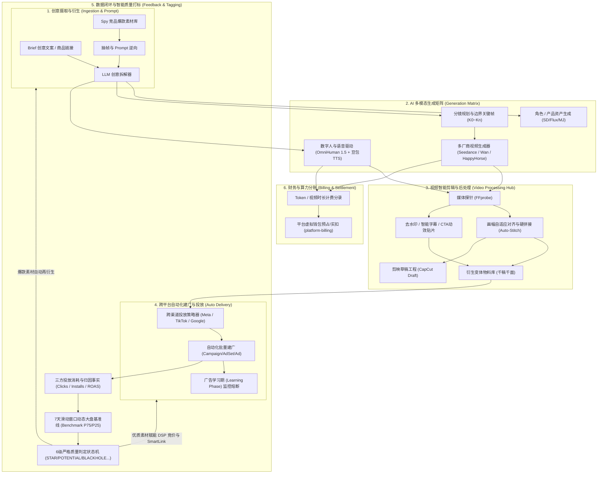
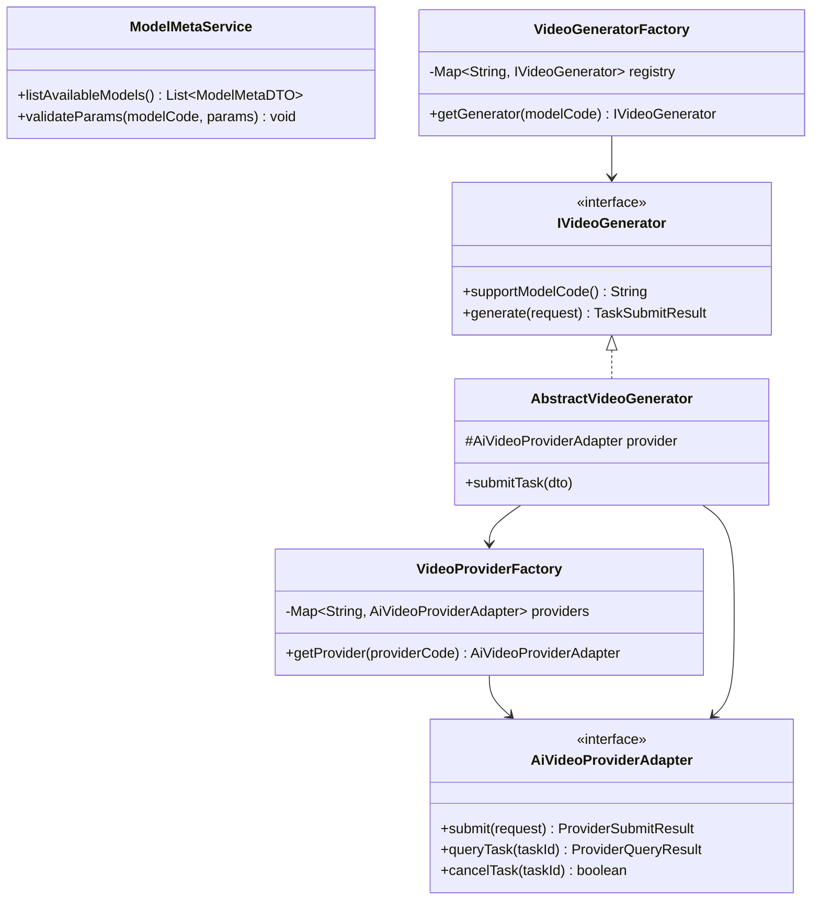
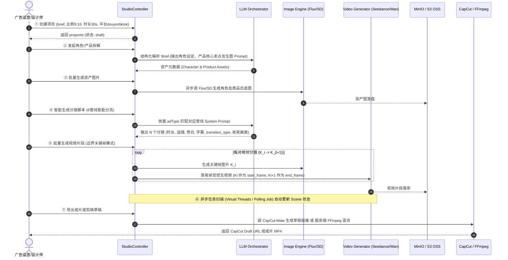
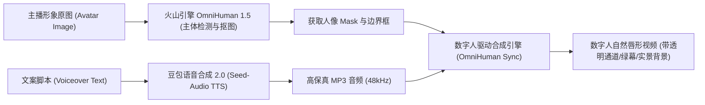
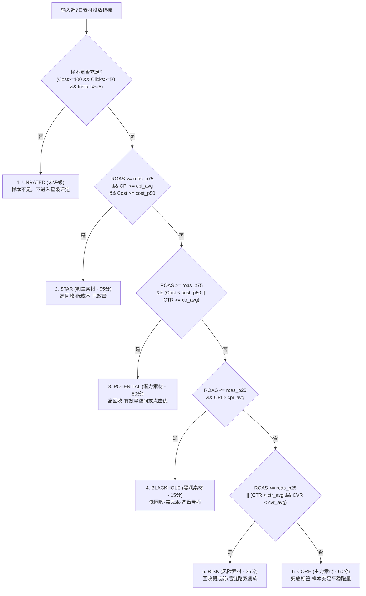

# Affiliate Platform 素材自动化与 AI 创意工作台系统指南
# (Creative Automation & AI Studio System Guide)

> **参考基线**：深度复用并演进项目中已验证的 AI 视频生产、智能混剪、效果数据闭环打标与跨媒体自动化建广等工业级工程实践。  
> **目标工程**：适配 `f:\Affiliate` 平台现有的 Java 21、Spring Boot 3.4、PostgreSQL 14+、Redis、Kafka、多租户隔离（TenantContext）及模块化单体架构。

---

## 1. 业务背景与系统定位

### 1.1 现状与核心痛点
在当前 `f:\Affiliate` 平台中，`platform-creative` 模块仅承载基础的静态物料元数据记录（宽度、高度、CDN 静态 URL、审核状态）。但在现代程序化广告（RTB/DSP）与网盟效果营销（Affiliate Marketing）业务中，广告素材是决定投放效果（CTR / CVR / ROAS / EPC）的第一生产力。平台当前面临四大核心痛点：
1. **素材生命周期极短，人工生产供不应求**：游戏 IAA、电商带货类短视频素材的疲劳衰退期仅为 3~7 天，依赖传统设计师手工剪辑无法满足“千人千面”高频测新要求。
2. **多模型接入割裂与高维护成本**：市面上视频大模型（字节 Seedance、阿里百炼 Wan/HappyHorse、Google Veo、开源 ComfyUI）协议各异、参数不一，缺少统一的业务语义抽象，前后端强耦合。
3. **效果数据与素材库脱节**：前端投放产生的事实消耗与转化数据无法自动反哺素材库，缺乏客观量化的“好坏素材”判定标尺。
4. **全链路自动化断点**：素材生成、二次拼接处理、渠道批量建广、学习期监控各环节割裂，运营需在多个后台手动搬砖。

### 1.2 系统定位与全链路闭环
本方案在 `platform-creative` 模块内构建完整的 **素材自动化闭环中枢 (Creative Automation Engine)**，横向拉通 AI 智能生成、数字人驱动、智能混剪后处理、效果数据智能打标、跨渠道自动化建广与财务分账，实现**从创意输入到广告投放、数据归因再到爆款衍生的全自动数据闭环**。



---

## 2. 总体架构与技术分层

遵循 `Affiliate Platform` 的依赖原则：`platform-api -> platform-creative -> platform-common`，并利用 PostgreSQL + Redis + Kafka + Flyway 基础设施，支持严格的多租户物理/逻辑隔离。

```
┌────────────────────────────────────────────────────────────────────────┐
│                        platform-api / REST Gateway                     │
│   CreativeAutomationController / StudioController / TaggingController │
├────────────────────────────────────────────────────────────────────────┤
│                      platform-creative (核心业务模块)                   │
│                                                                        │
│  ┌───────────────────────┐  ┌───────────────────────┐  ┌─────────────┐ │
│  │ 1. AI 视频多模型引擎   │  │ 2. AI 长视频工作台     │  │ 3. 智能剪辑  │ │
│  │   - ModelMeta 动态元数据│  │   - 7阶段工程流水线   │  │ - 媒体探针  │ │
│  │   - Generator (业务映射)│  │   - 6管线分镜Prompt体系 │  │ - 画幅对齐  │ │
│  │   - Provider (协议适配)│  │   - 边界关键帧法生成    │  │ - 物理硬拼接│ │
│  │   - 异步生命周期轮询    │  │   - 剪映草稿/本地FFmpeg │  │ - 5大算子   │ │
│  └───────────────────────┘  └───────────────────────┘  └─────────────┘ │
│  ┌───────────────────────┐  ┌───────────────────────┐  ┌─────────────┐ │
│  │ 4. 数字人与语音克隆   │  │ 5. 效果质量打标系统   │  │ 6. 自动化投放│ │
│  │   - OmniHuman 1.5 驱动│  │   - 3重样本保护门槛    │  │ - 跨媒体建广│ │
│  │   - 豆包 TTS 2.0 合成 │  │   - 动态 7D 基准线引擎  │  │ - 学习期监控│ │
│  │   - 绿幕抠图与唇形对齐  │  │   - 6级质量状态机     │  │ - 业务联动  │ │
│  └───────────────────────┘  └───────────────────────┘  └─────────────┘ │
│  ┌──────────────────────────────────────────────────┐  ┌─────────────┐ │
│  │ 7. 计费分账闭环 (Billing & Token Settlement)      │  │ 8. Spy 灵感 │ │
│  │   - 视频秒数/Token计量  - 租户预占/实扣            │  │ - 抽帧逆向  │ │
│  └──────────────────────────────────────────────────┘  └─────────────┘ │
├────────────────────────────────────────────────────────────────────────┤
│                       platform-common & 外部基础设施                    │
│   Creative Domain / TenantContext / EventOutbox (Kafka) / S3 OSS /     │
│   PostgreSQL 14+ / Redis / FFmpeg / DashScope / ByteDance Ark / Meta   │
└────────────────────────────────────────────────────────────────────────┘
```

---

## 3. 八大核心子系统详细设计

### 3.1 AI 视频生成服务架构 (Generator + Provider + Model Meta)

为彻底解决“厂商接口繁杂、新模型接入前后端硬编码”的工程痛点，完全复刻 `media-hub` 的经典三层解耦架构：



#### 职责划分说明
1. **Model Meta 层（元数据层）**：定义模型能力编码（如 `ark_seedance_2_0`、`dashscope_wan_2_1`）、输入参数约束（是否必填起始图、是否支持尾帧、分辨率枚举、运镜控制）、单价及计费倍率。前端根据元数据动态渲染表单，无需每次硬编码。
2. **Generator 层（模型业务语义层）**：负责业务请求向模型入参的映射与归一化。例如将 `generateType`（`TEXT_TO_VIDEO`, `IMAGE_TO_VIDEO`, `REFERENCE_TO_VIDEO`, `VIDEO_EDIT`）转化为具体模型 prompt 模版、长宽比格式换算。
3. **Provider Adapter 层（厂商协议适配层）**：只负责上游 HTTP 鉴权、签名（如火山引擎 HMAC-SHA256、阿里百炼 Bearer Token）、网络重试、原始错误码转本地标准异常、轮询状态提取。

#### 异步任务状态机与双重转存
```
[SUBMITTED] -> [PENDING] -> [PROCESSING] -> [SUCCESS_FETCHED] -> [SUCCESS] (转存自身 S3/MinIO OSS 完成)
                                        \-> [FAILED] (记录错误分类: SENSITIVE_WORDS, UPSTREAM_TIMEOUT, PARAM_INVALID)
```
> **转存机制**：上游第三方厂商通常仅保留生成结果 24 小时。系统在进入 `SUCCESS_FETCHED` 状态后，立即由后台流式拉取视频并直传平台私有 S3 对象存储，写回 `oss_url` 后标记为终态 `SUCCESS`，确保素材资产长期可访问。

---

### 3.2 AI 长视频工作台 (Long Video Studio: 7-Stage Pipeline)

针对视频大模型单次仅能生成 3~10 秒视频的限制，采用 **7 阶段工程流水线** 与 **“边界关键帧法”**。



#### 6 大行业分镜提示词管线 (Prompt Pipeline)
为确保分镜质量满足专业广告投放标准，系统预设 6 套行业管线：
1. **电商口播带货管线 (E-commerce Showcase)**：黄金3秒 Hook 痛点抛出 $\to$ 产品核心成分/卖点展示 $\to$ 权威背书/使用对比 $\to$ 限时福利与 CTA。
2. **IAA 小游戏/互动试玩管线 (Gaming & Interactive)**：极度抓狂的失败操作演示 $\to$ 神级翻盘操作 $\to$ 炫酷道具与特效展示 $\to$ 引导点击“免费畅玩”。
3. **短剧/剧情反转管线 (Drama Hook & Twist)**：高冲突矛盾开场（出轨/羞辱/打脸） $\to$ 身份反转 $\to$ 卡点悬念戛然而止 $\to$ 引导看下一集。
4. **品牌形象/故事片管线 (Brand Cinematic)**：电影级画质与运镜、宏大叙事、情感共鸣、品牌 Logo 定格。
5. **促销活动/限时特惠强刺激管线 (Flash Sale Promo)**：大字报、倒计时动效、超高性价比冲击、催促立即抢购。
6. **本地生活/探店测评管线 (Local Lifestyle Review)**：第一人称沉浸式进店、招牌菜品特写、价格与优惠披露、位置引导。

#### 分镜连接控制规范 (`transition_type` 与「收尾画面」)
每个分镜生成的 Prompt 必须遵循严格的 JSON 约束规范：
```json
{
  "scenes": [
    {
      "scene_index": 1,
      "prompt": "特写镜头，一个疲惫的年轻白领女性揉着太阳穴，办公桌上堆满文件，冷色调荧光灯光。镜头缓慢推近。收尾画面：女性猛然抬头，眼神中闪烁出惊喜与好奇。",
      "voiceover_text": "天天熬夜加班，头发大把大把掉？",
      "voiceover_tone": "温暖女声",
      "voiceover_speed": "normal",
      "subtitle_text": "天天熬夜加班？脱发太严重！",
      "subtitle_keywords": ["熬夜", "脱发"],
      "duration_seconds": 5,
      "bgm_cue": "轻电子流行 BPM110 从舒缓低沉逐渐走向高潮",
      "transition_type": "chain_extend",
      "transition_desc": "上一镜收尾画面作为本镜起始输入，角色动作连续延展"
    }
  ]
}
```
- **`transition_type` 枚举**：
  - `hard_cut`：叙事跳转（Hook $\to$ 痛点，痛点 $\to$ 产品登场），节奏突变直接硬切。
  - `chain_extend`：此镜收尾画面作为下一镜的起始画面输入（边界关键帧法），动作丝滑延续。
  - `match_cut`：匹配剪辑（如从圆形钟表匹配切换到圆形药瓶），实现高质感艺术转场。
  - `same_scene`：同场景多机位切换。

---

### 3.3 数字人驱动与多模态语音克隆 (Digital Human & TTS Audio Studio)

针对不需要复杂剧情、只需口播介绍的 IAA/电商广告，集成轻量化数字人驱动矩阵：



1. **主体检测与抠图 (Subject Detection)**：调用火山引擎即梦 OmniHuman 1.5 `CVSync2AsyncSubmitTask`，自动识别人脸、身体边界并输出 Mask，支持一键替换广告主品牌背景。
2. **豆包语音合成 2.0 (Seed-Audio TTS)**：
   - 使用 `X-Api-App-Id` + `X-Api-Access-Key` 双头鉴权。
   - 提供 50+ 种高转化音色（沉稳男声、活力女声、幽默说书人、英语 Native 口音），支持 `speed` (0.8~1.5x) 与情绪风格调节。
   - 自动返回音频时长（毫秒精度），反向校准分镜视频生成的 `duration_seconds`，实现**音画严格同步**。

---

### 3.4 双模导出体系：剪映草稿协议 (CapCut Draft) 与本地 FFmpeg 混流

#### 1. 剪映草稿协议微秒级导出 (`CapCutMateClient`)
为了让设计师能在专业剪辑软件中进行微调二次创作，系统对接 `CapCut-Mate` 协议，输出可直接在桌面端/移动端打开的工程文件：
- 自动按 `aspectRatio` 计算工程分辨率（9:16 $\to$ 1080x1920，16:9 $\to$ 1920x1080）。
- **时间轴游标（微秒精度）计算**：
  $$\text{start} = \text{cursor}, \quad \text{end} = \text{cursor} + \text{durationUs}, \quad \text{cursor} \mathrel{+}= \text{durationUs}$$
- 自动向工程中注入：
  - 视频轨（Track 1）：各分镜生成的 MP4 视频切片。
  - 旁白音频轨（Track 2）：TTS 合成的多段分镜配音。
  - 背景音乐轨（Track 3）：根据 `bgm_cue` 检索注入的免版权音乐，自动做淡入淡出（Fade-in / Fade-out）。
  - 字幕文本轨（Track 4）：带有高亮关键词样式（颜色、字号、描边）的字幕片段。

#### 2. 本地高保真 FFmpeg 渲染流水线
对于无需人工复审的纯自动化流水线，系统直接在容器内调用 FFmpeg 执行一键成片：
```bash
# 统一视频画幅、帧率与音频重采样，压制字幕并合成
ffmpeg -y -f concat -safe 0 -i clips.txt \
  -i bgm.mp3 \
  -filter_complex "[0:v]fps=30,scale=1080:1920:force_original_aspect_ratio=decrease,pad=1080:1920:(ow-iw)/2:(oh-ih)/2,subtitles=sub.srt:force_style='Fontname=SimHei,FontSize=20,PrimaryColour=&H00FFFFFF,Outline=2'[v];[1:a]volume=0.3[bgm];[0:a][bgm]amix=inputs=2:duration=first[a]" \
  -map "[v]" -map "[a]" -c:v libx264 -crf 20 -preset fast -c:a aac -b:a 192k output_final.mp4
```

---

### 3.5 视频智能剪辑与混剪中心 (Video Processing Hub)

面向广告投放“千稿千面”测新诉求，构建高效视频后处理引擎：

#### 1. 媒体探针 (MediaProbe)
基于 `FFprobe` / `JavaCV` 准确探测视频流属性：`width`, `height`, `aspect_ratio`, `duration`, `video_codec` (h264/hevc), `fps`, `audio_sample_rate` (44.1k/48k)。

#### 2. 画幅自适应对齐与硬拼接 (Auto-Stitch Engine)
- **策略**：当用户将 AI 生成的 Hook 片头（如 9:16）与素材库中的实拍片段（如 16:9 或 1:1）拼接时，系统以目标比例为主，执行：
  $$\text{ScaleToFit} \to \text{Padding (Letterbox/Pillarbox 黑边自适应填充)} \to \text{Resample Audio to 48kHz Stereo} \to \text{Concat}$$
- **避免不必要重编码**：对于相同分辨率、相同编码规范的切片，启用 `-c copy` 极速流拼接；对异构切片执行统一直播级 H.264 CRF 20 调优转码。

#### 3. 五大原子后处理算子
1. **去水印 (Watermark Removal)**：基于预设坐标或 OCR 检测蒙版，执行基于 Delogo 算法的边缘平滑擦除。
2. **智能字幕 (Subtitle Processor)**：ASR 识别音频生成时间轴 SRT，通过 Libass 渲染精美广告字体与描边。
3. **片头注入 (Intro Splicing)**：在原视频前 2~3 秒无缝插入黄金 Hook 吸引点击。
4. **行动呼吁贴片 (CTA Overlay)**：在视频末尾 3~5 秒以画中画动效叠加入口浮层（如“立即下载”、“限时折扣”）。
5. **分段裁剪 (Trim)**：无损去除无效尾巴或冗长停顿。

---

### 3.6 素材质量评估与动态基准线打标系统

完全采纳 `media-hub` 验证的**全盘 7 天滑动窗口动态大盘基准线**与**严格优先级判定机制**，拒绝主观拍脑袋。

#### 1. 生产级数仓 ETL 计算 SQL (`dws_material_benchmark_7d`)
在数仓（PostgreSQL/Hologres）中每天凌晨定时执行以下脚本，计算滑动基准线：

```sql
WITH const AS (
    -- 三重样本保护门槛 (有效样本保护)
    SELECT  CAST(100.00 AS NUMERIC(18,6)) AS sample_cost_threshold,
            CAST(50     AS BIGINT)        AS sample_click_threshold,
            CAST(5      AS BIGINT)        AS sample_install_threshold
),
win AS (
    -- 7 天动态滑动时间窗口
    SELECT  ('${stat_date}')::DATE      AS stat_date,
            ('${stat_date}')::DATE - 6 AS window_start_date,
            ('${stat_date}')::DATE     AS window_end_date
),
raw AS (
    SELECT  a.day,
            a.material_id,
            COALESCE(a.promotion_cost, 0)    AS promotion_cost,
            COALESCE(a.install_num, 0)       AS install_num,
            COALESCE(a.impressions, 0)       AS impressions,
            COALESCE(a.clicks, 0)            AS clicks,
            COALESCE(a.conversion_values, 0) AS conversion_values
    FROM dwd_ad_channel_material_day_fact a
    CROSS JOIN win w
    WHERE a.day::DATE >= w.window_start_date
      AND a.day::DATE <= w.window_end_date
      AND a.material_id IS NOT NULL
),
m AS (
    SELECT  material_id,
            SUM(promotion_cost)    AS promotion_cost,
            SUM(install_num)       AS install_num,
            SUM(impressions)       AS impressions,
            SUM(clicks)            AS clicks,
            SUM(conversion_values) AS conversion_values
    FROM raw
    GROUP BY material_id
),
m_metric AS (
    SELECT  m.*,
            CAST(m.clicks AS NUMERIC(18,6)) / NULLIF(CAST(m.impressions AS NUMERIC(18,6)), 0)         AS ctr,
            CAST(m.install_num AS NUMERIC(18,6)) / NULLIF(CAST(m.clicks AS NUMERIC(18,6)), 0)         AS cvr_install,
            CAST(m.promotion_cost AS NUMERIC(18,6)) / NULLIF(CAST(m.install_num AS NUMERIC(18,6)), 0) AS cpi,
            CAST(m.conversion_values AS NUMERIC(18,6)) / NULLIF(CAST(m.promotion_cost AS NUMERIC(18,6)), 0) AS roas
    FROM m
    CROSS JOIN const c
    -- 核心：数仓算基准时只取达标的有效样本，防止噪音数据带偏大盘
    WHERE m.promotion_cost >= c.sample_cost_threshold
      AND m.clicks >= c.sample_click_threshold
      AND m.install_num >= c.sample_install_threshold
)
INSERT INTO dws_material_benchmark_7d (
    stat_date, window_start_date, window_end_date,
    material_sample_count, sample_cost_threshold, sample_click_threshold, sample_install_threshold,
    roas_p75, roas_p25, cost_p50, cpi_avg, ctr_avg, cvr_install_avg, created_at
)
SELECT  w.stat_date,
        w.window_start_date,
        w.window_end_date,
        COUNT(1)                                                     AS material_sample_count,
        MAX(c.sample_cost_threshold)                                 AS sample_cost_threshold,
        MAX(c.sample_click_threshold)                                AS sample_click_threshold,
        MAX(c.sample_install_threshold)                              AS sample_install_threshold,
        PERCENTILE_CONT(0.75) WITHIN GROUP (ORDER BY m_metric.roas)  AS roas_p75,
        PERCENTILE_CONT(0.25) WITHIN GROUP (ORDER BY m_metric.roas)  AS roas_p25,
        PERCENTILE_CONT(0.50) WITHIN GROUP (ORDER BY m_metric.promotion_cost) AS cost_p50,
        AVG(m_metric.cpi)                                            AS cpi_avg,
        AVG(m_metric.ctr)                                            AS ctr_avg,
        AVG(m_metric.cvr_install)                                    AS cvr_install_avg,
        NOW()                                                        AS created_at
FROM m_metric
CROSS JOIN win w
CROSS JOIN const c
GROUP BY w.stat_date, w.window_start_date, w.window_end_date;
```

#### 2. 严格判定状态机（短路优先级不可更改）
根据当日 `dws_material_benchmark_7d`，中台对素材执行如下严格优先级的打标计算：



---

### 3.7 跨平台自动化建广、学习期监控与核心业务深度赋能

#### 1. 跨媒体 API 自动化建广
- **Meta (Facebook Graph API)**：通过批量任务创建 Campaign $\to$ AdSet（配置 Pixel、自定义受众、年龄性别国家定向） $\to$ Ad（上传视频 Hash、配置广告文案与落地页链接）。
- **TikTok Commercial API**：创建 APP_PROMOTION 活动、配置 Spark Ads 授权、绑定 TikTok Pixel 与自动出价策略。

#### 2. 广告学习期 (Learning Phase) 监控规则与自动熔断
- **规则定义**：
  $$\text{IsLearning} = \left(\text{FirstMetricTime} \neq \text{null}\right) \land \left(\text{Now} < \text{FirstMetricTime} + \text{TimeDays}\right) \land \left(\text{CumulativeCost} \le \text{CostThreshold}\right)$$
- **联动策略**：
  - 学习期内（如 2 天内且消耗 $\le \$50$）：锁死出价，禁止人工频繁调整导致模型震荡。
  - 学习期失败或命中 `BLACKHOLE`：自动触发飞书/邮件预警，建议自动降低预算或下线换量。
  - 命中 `STAR`：自动提取该素材参数，推荐至新 Campaign 扩量。

#### 3. 与 `platform-dsp` 及 `platform-affiliate` 的深度赋能
- **赋能 DSP 实时竞价引擎**：
  - 命中 `STAR` 素材：DSP 竞价预测模块将预估点击率乘以增益因子 $\text{pCTR} \times 1.25$，同时降低 Bid Shading 阻尼折扣，确保明星素材以极具竞争力的价格胜出高价值曝光。
  - 命中 `BLACKHOLE` / `RISK` 素材：DSP 自动将出价降权 50% 或直接置为不可竞价状态，避免预算浪费。
- **赋能 Affiliate SmartLink / TDS 流量分流引擎**：
  - 拥有 `STAR` 素材的 Offer 会在 TDS 路由引擎中动态获得更高的转化能力（EPC）权重，优先接收高转化国家与优质渠道的流量导入；黑洞素材 Offer 触发流量降权并分流至兜底 Fallback Offer。

---

### 3.8 AI 生成与计费分账闭环 (`platform-billing` 集成)

参考 `media-hub` 中的原生模型分账脚本设计，将 AI 视频算力开销纳入 `platform-billing` 体系：

1. **统一计费度量**：
   - 视频模型：按有效生成时长计费（`usage_unit = 'SECOND'`），例如 Seedance 2.0 约为 0.15 元/秒。
   - 文本/语言模型：按 Token 计费（`usage_unit = 'TOKEN'`）。
2. **两阶段资金管控（预占与实扣）**：
   - **创建任务前**：根据 `estimatedDurationSeconds` 调用 `platform-billing` 的 `reserve(...)`，在租户虚拟钱包中原子冻结点数。
   - **生成成功终态**：任务进入 `SUCCESS` 时，提取实际秒数，调用 `confirm(...)` 生成不可变账单分录（`creative_ai_billing_ledger`）。
   - **生成失败/取消**：调用 `release(...)` 立即全额解冻退回。
3. **部门与项目 ROI 结算**：
   - 支持跨租户、部门、广告项目汇总 AI 生成总成本，并与带来的广告实际收益对比，输出**AI 生产投产比（AI Generation ROI）**。

---

## 4. 数据库详细设计 (PostgreSQL 14+ DDL)

所有表结构严格遵循 `f:\Affiliate` 标准：字段全小写下划线、包含多租户物理/逻辑隔离字段 `tenant_id`、具备完整的外键/唯一约束与复合高性能索引。

```sql
-- ===================================================================
-- 模块名称：platform-creative 素材自动化核心扩展
-- 适用数据库：PostgreSQL 14+
-- ===================================================================

-- 1. AI 视频模型元数据表 (Model Meta)
CREATE TABLE IF NOT EXISTS creative_ai_model_meta (
    id VARCHAR(64) PRIMARY KEY,
    tenant_id VARCHAR(64) NOT NULL DEFAULT 'public',
    model_code VARCHAR(64) NOT NULL,               -- 模型唯一编码 (ark_seedance_2_0, happyhorse_1_1)
    model_name VARCHAR(128) NOT NULL,              -- 展示名称
    provider_code VARCHAR(64) NOT NULL,            -- 供应商编码 (DASHSCOPE, BYTEDANCE_ARK, OPENROUTER)
    supported_types JSONB NOT NULL DEFAULT '[]',   -- 支持的类型 ["TEXT_TO_VIDEO", "IMAGE_TO_VIDEO", "VIDEO_EDIT"]
    field_schema JSONB NOT NULL DEFAULT '{}',      -- 前端表单动态渲染约束 (分辨率、时长、运镜选项)
    billing_unit VARCHAR(16) NOT NULL DEFAULT 'SECOND', -- SECOND / TOKEN
    unit_price NUMERIC(10, 4) NOT NULL DEFAULT 0.1500, -- 单价 (元/秒 或 元/千Token)
    pricing_multiplier NUMERIC(10, 4) DEFAULT 1.0, -- 计费倍率
    enabled BOOLEAN NOT NULL DEFAULT TRUE,
    created_at TIMESTAMPTZ NOT NULL DEFAULT NOW()
);
CREATE UNIQUE INDEX IF NOT EXISTS uk_ai_model_meta ON creative_ai_model_meta(tenant_id, model_code);

-- 2. 统一异步生成任务记录表 (Task Record)
CREATE TABLE IF NOT EXISTS creative_ai_task_record (
    id VARCHAR(64) PRIMARY KEY,
    tenant_id VARCHAR(64) NOT NULL DEFAULT 'public',
    task_no VARCHAR(64) NOT NULL,                  -- 业务任务单号 (UUID)
    generate_type VARCHAR(32) NOT NULL,            -- 任务类型 (T2V, I2V, STORYBOARD, STITCH, DIGITAL_HUMAN)
    model_code VARCHAR(64) NOT NULL,
    provider_code VARCHAR(64) NOT NULL,
    remote_task_id VARCHAR(128),                   -- 上游厂商异步任务ID
    status VARCHAR(32) NOT NULL DEFAULT 'PENDING', -- PENDING, PROCESSING, SUCCESS_FETCHED, SUCCESS, FAILED
    prompt TEXT,                                   -- 提示词
    input_assets_json JSONB DEFAULT '{}',          -- 输入资源 (首尾帧、参考图URL)
    raw_output_url TEXT,                           -- 上游返回原始临时下载URL
    oss_url TEXT,                                  -- 转存至自身平台 S3/MinIO OSS 的永久 URL
    duration_seconds INT,
    usage_unit VARCHAR(16) DEFAULT 'SECOND',       -- 计费单位
    usage_quantity NUMERIC(12, 2) DEFAULT 0.00,    -- 实际产生计费量 (如生成5秒)
    estimated_cost NUMERIC(12, 4) DEFAULT 0.0000,  -- 产生费用 (元)
    cost_status VARCHAR(32) DEFAULT 'PENDING',     -- PENDING, CALCULATED, SETTLED
    error_code VARCHAR(64),
    error_message TEXT,
    created_by VARCHAR(64),
    created_at TIMESTAMPTZ NOT NULL DEFAULT NOW(),
    finished_at TIMESTAMPTZ
);
CREATE INDEX IF NOT EXISTS ix_ai_task_status ON creative_ai_task_record(tenant_id, status, created_at DESC);
CREATE INDEX IF NOT EXISTS ix_ai_task_no ON creative_ai_task_record(tenant_id, task_no);

-- 3. AI 算力消耗计费分录表 (Billing Ledger)
CREATE TABLE IF NOT EXISTS creative_ai_billing_ledger (
    id VARCHAR(64) PRIMARY KEY,
    tenant_id VARCHAR(64) NOT NULL DEFAULT 'public',
    task_id VARCHAR(64) NOT NULL REFERENCES creative_ai_task_record(id),
    department_id VARCHAR(64),
    project_id VARCHAR(64),
    model_code VARCHAR(64) NOT NULL,
    deducted_amount NUMERIC(12, 4) NOT NULL,       -- 扣减金额
    wallet_balance_after NUMERIC(12, 4) NOT NULL,  -- 扣减后钱包余额
    idempotent_key VARCHAR(128) NOT NULL,          -- 幂等校验键
    settled_at TIMESTAMPTZ NOT NULL DEFAULT NOW()
);
CREATE UNIQUE INDEX IF NOT EXISTS uk_ai_billing_idempotent ON creative_ai_billing_ledger(tenant_id, idempotent_key);

-- 4. AI 长视频项目表 (Long Video Project)
CREATE TABLE IF NOT EXISTS creative_studio_project (
    id VARCHAR(64) PRIMARY KEY,
    tenant_id VARCHAR(64) NOT NULL DEFAULT 'public',
    title VARCHAR(255) NOT NULL,
    brief TEXT,                                    -- 创意文案与推广诉求
    aspect_ratio VARCHAR(16) DEFAULT '9:16',       -- 画幅比例
    duration_seconds INT DEFAULT 30,               -- 目标总时长
    target_platform VARCHAR(64) DEFAULT 'tiktok',  -- 目标投放渠道
    ad_type VARCHAR(64) DEFAULT 'direct_response', -- 广告类型 (电商带货, IAA小游戏, 应用安装)
    creative_style VARCHAR(64) DEFAULT 'live_action',
    model_code VARCHAR(64) DEFAULT 'ark_seedance_2_0',
    status VARCHAR(32) DEFAULT 'draft',            -- draft, script_ready, generating, completed, failed
    final_video_url TEXT,                          -- 最终合成导出视频 URL
    capcut_draft_url TEXT,                         -- 剪映/CapCut草稿下载包或导入链接
    created_by VARCHAR(64),
    created_at TIMESTAMPTZ NOT NULL DEFAULT NOW(),
    updated_at TIMESTAMPTZ NOT NULL DEFAULT NOW()
);
CREATE INDEX IF NOT EXISTS ix_studio_project_tenant ON creative_studio_project(tenant_id, created_at DESC);

-- 5. AI 长视频资产表 (Studio Asset: 角色与产品)
CREATE TABLE IF NOT EXISTS creative_studio_asset (
    id VARCHAR(64) PRIMARY KEY,
    tenant_id VARCHAR(64) NOT NULL DEFAULT 'public',
    project_id VARCHAR(64) NOT NULL REFERENCES creative_studio_project(id) ON DELETE CASCADE,
    asset_type VARCHAR(32) NOT NULL,               -- CHARACTER, PRODUCT, SCENE_SETTING
    name VARCHAR(128) NOT NULL,
    description TEXT,
    prompt_data_json JSONB DEFAULT '{}',           -- 用于生成资产图的提示词
    image_url TEXT,                                -- 资产图 OSS 访问链接
    status VARCHAR(32) DEFAULT 'draft',            -- draft, generated, confirmed
    created_at TIMESTAMPTZ NOT NULL DEFAULT NOW()
);
CREATE INDEX IF NOT EXISTS ix_studio_asset_project ON creative_studio_asset(tenant_id, project_id);

-- 6. AI 工作台分镜表 (Studio Scene)
CREATE TABLE IF NOT EXISTS creative_studio_scene (
    id VARCHAR(64) PRIMARY KEY,
    tenant_id VARCHAR(64) NOT NULL DEFAULT 'public',
    project_id VARCHAR(64) NOT NULL REFERENCES creative_studio_project(id) ON DELETE CASCADE,
    scene_index INT NOT NULL,                      -- 分镜序号 (1, 2, 3...)
    duration_seconds INT DEFAULT 5,                -- 单镜头预估时长 (3~15秒)
    shot_prompt TEXT NOT NULL,                     -- 镜头画面描述 (含末尾「收尾画面：xxx」)
    voiceover_text TEXT,                           -- 旁白文案正文
    voiceover_tone VARCHAR(64) DEFAULT '温暖女声',  -- 旁白音色
    voiceover_speed VARCHAR(16) DEFAULT 'normal',  -- 语速
    subtitle_text TEXT,                            -- 字幕文字 (每行<=15字)
    subtitle_keywords JSONB DEFAULT '[]',          -- 高亮关键词数组
    bgm_cue VARCHAR(255),                          -- BGM三维提示词 (风格+BPM+情绪走向)
    transition_type VARCHAR(32) DEFAULT 'chain_extend', -- hard_cut, chain_extend, match_cut, same_scene
    transition_desc TEXT,                          -- 衔接过渡说明
    start_keyframe_url TEXT,                       -- 起始边界关键帧 URL
    end_keyframe_url TEXT,                         -- 结束边界关键帧 URL
    video_clip_url TEXT,                           -- 当前镜头生成视频片段 OSS URL
    task_id VARCHAR(64),                           -- 关联的生成任务 ID
    status VARCHAR(32) DEFAULT 'draft',            -- draft, generating, generated, failed
    created_at TIMESTAMPTZ NOT NULL DEFAULT NOW()
);
CREATE INDEX IF NOT EXISTS ix_studio_scene_project ON creative_studio_scene(tenant_id, project_id, scene_index);

-- 7. 数字人形象资产库 (Digital Human Avatar)
CREATE TABLE IF NOT EXISTS creative_digital_human_avatar (
    id VARCHAR(64) PRIMARY KEY,
    tenant_id VARCHAR(64) NOT NULL DEFAULT 'public',
    avatar_name VARCHAR(128) NOT NULL,
    avatar_type VARCHAR(32) NOT NULL DEFAULT '2D_PHOTO', -- 2D_PHOTO, 3D_MODEL
    original_image_url TEXT NOT NULL,              -- 原始人像图 URL
    mask_image_url TEXT,                           -- 抠图主体 Mask URL
    default_speaker VARCHAR(64) DEFAULT 'zh_female_shuangkuai', -- 默认豆包TTS音色
    status VARCHAR(32) DEFAULT 'ACTIVE',
    created_at TIMESTAMPTZ NOT NULL DEFAULT NOW()
);
CREATE INDEX IF NOT EXISTS ix_digital_avatar ON creative_digital_human_avatar(tenant_id, status);

-- 8. 视频智能剪辑与混剪任务表 (Video Process Task)
CREATE TABLE IF NOT EXISTS creative_video_process_task (
    id VARCHAR(64) PRIMARY KEY,
    tenant_id VARCHAR(64) NOT NULL DEFAULT 'public',
    task_no VARCHAR(64) NOT NULL,
    process_type VARCHAR(32) NOT NULL,             -- INTRO_STITCH, WATERMARK_REMOVE, SUBTITLE, CTA_OVERLAY, BATCH_ASSEMBLE
    source_video_url TEXT NOT NULL,
    intro_video_url TEXT,                          -- 片头素材 (拼接时使用)
    target_width INT,
    target_height INT,
    align_mode VARCHAR(32) DEFAULT 'LETTERBOX',    -- 画幅对齐模式: LETTERBOX, CROP, SCALE
    status VARCHAR(32) NOT NULL DEFAULT 'PENDING', -- PENDING, PROCESSING, SUCCESS, FAILED
    output_video_url TEXT,
    output_cover_url TEXT,
    duration_seconds NUMERIC(10, 2),
    file_size_bytes BIGINT,
    created_at TIMESTAMPTZ NOT NULL DEFAULT NOW(),
    finished_at TIMESTAMPTZ
);
CREATE INDEX IF NOT EXISTS ix_process_task ON creative_video_process_task(tenant_id, status);

-- 9. 定时批量混剪配置表 (Auto Stitch Config)
CREATE TABLE IF NOT EXISTS creative_auto_stitch_config (
    id VARCHAR(64) PRIMARY KEY,
    tenant_id VARCHAR(64) NOT NULL DEFAULT 'public',
    config_name VARCHAR(128) NOT NULL,
    folder_sources JSONB NOT NULL DEFAULT '[]',     -- 来源物料文件夹集合 (含片头组与主体组)
    target_aspect_ratio VARCHAR(16) DEFAULT '9:16',
    align_mode VARCHAR(32) DEFAULT 'LETTERBOX',
    cta_config JSONB DEFAULT '{}',
    scheduled_time TIMESTAMPTZ,                    -- 计划执行时间
    status VARCHAR(32) DEFAULT 'PENDING',          -- PENDING, EXECUTED, CANCELLED
    created_at TIMESTAMPTZ NOT NULL DEFAULT NOW()
);
CREATE INDEX IF NOT EXISTS ix_auto_stitch_schedule ON creative_auto_stitch_config(tenant_id, status, scheduled_time);

-- 10. 7日大盘质量基准线快照表 (Benchmark 7D)
CREATE TABLE IF NOT EXISTS creative_benchmark_7d (
    id VARCHAR(64) PRIMARY KEY,
    tenant_id VARCHAR(64) NOT NULL DEFAULT 'public',
    stat_date DATE NOT NULL,                       -- 统计日期 (基准产生日)
    window_start_date DATE NOT NULL,               -- 滑动窗口开始 (stat_date - 6)
    window_end_date DATE NOT NULL,                 -- 滑动窗口结束 (stat_date)
    material_sample_count INT NOT NULL,            -- 参与基准统计的有效样本数
    sample_cost_threshold NUMERIC(12, 2) DEFAULT 100.00,
    sample_click_threshold BIGINT DEFAULT 50,
    sample_install_threshold BIGINT DEFAULT 5,
    roas_p75 NUMERIC(10, 4) NOT NULL,              -- 明星素材及格线
    roas_p25 NUMERIC(10, 4) NOT NULL,              -- 风险警戒线
    cost_p50 NUMERIC(12, 2) NOT NULL,              -- 放量门槛中位数
    cpi_avg NUMERIC(10, 4) NOT NULL,
    ctr_avg NUMERIC(10, 4) NOT NULL,
    cvr_install_avg NUMERIC(10, 4) NOT NULL,
    created_at TIMESTAMPTZ NOT NULL DEFAULT NOW()
);
CREATE UNIQUE INDEX IF NOT EXISTS uk_benchmark_stat ON creative_benchmark_7d(tenant_id, stat_date);

-- 11. 素材质量标签历史快照与明细表 (Quality Tag History)
CREATE TABLE IF NOT EXISTS creative_quality_tag_history (
    id VARCHAR(64) PRIMARY KEY,
    tenant_id VARCHAR(64) NOT NULL DEFAULT 'public',
    creative_id VARCHAR(64) NOT NULL,              -- 对应 platform-creative 的 creative.id
    stat_date DATE NOT NULL,
    quality_level VARCHAR(32) NOT NULL,            -- UNRATED, STAR, POTENTIAL, CORE, RISK, BLACKHOLE
    score NUMERIC(5, 2) NOT NULL,                  -- 评级综合分
    promotion_cost_7d NUMERIC(12, 2) NOT NULL,     -- 7天实际消耗
    clicks_7d BIGINT NOT NULL,
    installs_7d BIGINT NOT NULL,
    roas_7d NUMERIC(10, 4) NOT NULL,
    cpi_7d NUMERIC(10, 4) NOT NULL,
    ctr_7d NUMERIC(10, 4) NOT NULL,
    reason_tags JSONB DEFAULT '[]',                -- 命中规则原因 (如 ["HIGH_ROAS", "LOW_CPI", "HIGH_COST"])
    benchmark_id VARCHAR(64),
    created_at TIMESTAMPTZ NOT NULL DEFAULT NOW()
);
CREATE INDEX IF NOT EXISTS ix_quality_tag_creative ON creative_quality_tag_history(tenant_id, creative_id, stat_date DESC);
CREATE INDEX IF NOT EXISTS ix_quality_tag_level ON creative_quality_tag_history(tenant_id, stat_date, quality_level);

-- 12. 广告学习期监控配置与状态表 (Ad Learning Rule)
CREATE TABLE IF NOT EXISTS creative_ad_learning_rule (
    id VARCHAR(64) PRIMARY KEY,
    tenant_id VARCHAR(64) NOT NULL DEFAULT 'public',
    entity_level VARCHAR(32) NOT NULL,             -- CAMPAIGN, ADSET, AD
    entity_id VARCHAR(64) NOT NULL,                -- 三方平台广告ID (Facebook/TikTok)
    entity_name VARCHAR(255),
    channel_code VARCHAR(32) NOT NULL,             -- FACEBOOK, TIKTOK, GOOGLE
    time_days INT NOT NULL DEFAULT 2,              -- 学习期天数门槛
    cost_threshold NUMERIC(12, 2) NOT NULL DEFAULT 50.00, -- 学习期消耗门槛
    first_metric_time TIMESTAMPTZ,                 -- 产生首次消耗事实的时间
    cumulative_cost NUMERIC(12, 2) DEFAULT 0.00,
    is_learning BOOLEAN NOT NULL DEFAULT TRUE,
    enabled BOOLEAN NOT NULL DEFAULT TRUE,
    created_at TIMESTAMPTZ NOT NULL DEFAULT NOW(),
    updated_at TIMESTAMPTZ NOT NULL DEFAULT NOW()
);
CREATE UNIQUE INDEX IF NOT EXISTS uk_learning_rule ON creative_ad_learning_rule(tenant_id, entity_level, entity_id);
```

---

## 5. 核心 RESTful API 契约设计

### 5.1 提交多模型 AI 视频生成任务
- **Endpoint**: `POST /api/v1/creative/ai/generate`
- **Request Body**:
```json
{
  "modelCode": "ark_seedance_2_0",
  "generateType": "IMAGE_TO_VIDEO",
  "prompt": "Cyberpunk girl turning her head and smiling into camera, neon rain reflection, 8k cinematic lighting. 收尾画面：女孩侧脸望向右侧虚空，霓虹倒影在瞳孔放大。",
  "aspectRatio": "9:16",
  "durationSeconds": 5,
  "startImageUrl": "https://cdn.affiliate.com/assets/img/start_01.jpg",
  "endImageUrl": "https://cdn.affiliate.com/assets/img/end_01.jpg",
  "extParams": {
    "motionStrength": "medium",
    "cameraMotion": "zoom_in"
  }
}
```
- **Response Body**:
```json
{
  "success": true,
  "code": "OK",
  "data": {
    "taskNo": "tsk_9a8f71b2",
    "status": "PROCESSING",
    "modelCode": "ark_seedance_2_0",
    "estimatedSeconds": 45,
    "estimatedCost": 0.75,
    "createdAt": "2026-10-14T17:15:00Z"
  }
}
```

### 5.2 数字人驱动口播生成
- **Endpoint**: `POST /api/v1/creative/ai/digital-human/drive`
- **Request Body**:
```json
{
  "avatarId": "avt_8801",
  "scriptText": "今天教大家一个爆单小妙招，新上线的这款工具简直太绝了！",
  "speakerCode": "zh_female_shuangkuai",
  "speechSpeed": "normal",
  "backgroundMode": "TRANSPARENT_GREEN"
}
```
- **Response Body**:
```json
{
  "success": true,
  "data": {
    "taskNo": "dh_task_3112",
    "status": "PROCESSING",
    "audioDurationSeconds": 4.8,
    "message": "TTS合成完毕，正在提交即梦OmniHuman唇形对齐渲染"
  }
}
```

### 5.3 导出剪映工程草稿 (CapCut Draft)
- **Endpoint**: `POST /api/v1/creative/studio/projects/{projectId}/export-capcut`
- **Response Body**:
```json
{
  "success": true,
  "data": {
    "projectId": "prj_202610_001",
    "totalScenes": 6,
    "totalDurationSeconds": 32,
    "draftUrl": "https://draft.capcut-mate.internal/open?id=draft_98fa77b0",
    "capcutPackageDownloadUrl": "https://oss.affiliate.com/drafts/prj_202610_001_capcut.zip"
  }
}
```

### 5.4 获取大盘基准线与素材质量评级推荐
- **Endpoint**: `GET /api/v1/creative/quality/recommend?creativeId=cr_10086`
- **Response Body**:
```json
{
  "success": true,
  "data": {
    "creativeId": "cr_10086",
    "statDate": "2026-10-14",
    "qualityLevel": "STAR",
    "score": 95.0,
    "metrics": {
      "cost7d": 1280.50,
      "clicks7d": 850,
      "installs7d": 120,
      "roas7d": 2.15,
      "cpi7d": 3.80,
      "ctr7d": 0.038
    },
    "benchmark": {
      "roasP75": 1.80,
      "roasP25": 0.90,
      "costP50": 800.00,
      "cpiAvg": 4.20
    },
    "reasonTags": [
      "ROAS_ABOVE_P75",
      "CPI_BELOW_AVG",
      "SCALE_ABOVE_P50"
    ],
    "actionAdvice": "HIGH_PRIORITY_EXPAND (推荐追加 50% 预算并衍生 5 组类似变体)"
  }
}
```

---

## 6. 高可用、安全与生产运维保障

### 6.1 Java 21 虚拟线程与长轮询并发治理
- AI 视频生成及后处理属于高 I/O 阻塞、耗时在 30 秒至 3 分钟的任务。传统 200 线程池极易耗尽导致整个 Web 容器假死。
- 全面引入 Java 21 虚拟线程（`Executors.newVirtualThreadPerTaskExecutor()`）。轮询任务在虚拟线程内执行 HTTP 查询与休眠，单节点可轻松挂载上万个并发轮询任务，内存开销仅传统线程的 1/50。

### 6.2 供应商限流防护 (Rate Limiting) 与多级熔断
- 各云厂商有极严苛的 QPS 限制（如阿里百炼 5 QPS，火山引擎 10 QPS）。
- **分布式令牌桶限流**：使用 Redis 实现各 Provider 的全局限流。
- **自动降级容错**：当首选模型（`ark_seedance_2_0`）返回 HTTP 429 或 503 时，断路器自动切换至候选兜底模型（`dashscope_wan_2_1` 或 `openrouter_veo`），防止流水线阻塞。

### 6.3 本地工作目录 (`workDir`) 与磁盘生命周期管理
- FFmpeg 拼接、探针探测与转码会产生临时切片。
- **防止磁盘打满机制**：
  1. 每个任务建立独立工作空间：`/tmp/creative_workspace/{task_no}`。
  2. 采用 `try-finally` 保证任务终态（成功或失败）后，立即递归清空工作目录。
  3. 后台守护定时任务每 30 分钟扫描一次，强行清理超过 2 小时的孤儿临时文件；当磁盘使用率超过 80% 时暂停接收本地混剪新任务，并告警运维。

### 6.4 内容安全与敏感词合规前置拦截
- 广告素材上线前，前端提交的 Prompt 文案、Brief 及 OCR 提取的字幕文本，必须前置通过内容安全审核中间件（敏感词词典 + 百度/阿里云文本反垃圾 API）。一旦命中涉政、涉暴、涉黄敏感词，直接阻断提交并标记任务为 `FAILED: SENSITIVE_WORDS_DETECTED`，避免三方厂商封禁 API Key。

---

## 7. 实施路线图与阶段性里程碑

| 阶段 | 周期 | 核心目标 | 关键交付物 |
|---|---|---|---|
| **Phase 1** | 第 1~2 周 | **素材效果数据闭环与智能质量打标** | 1. 建立 7 天滑动窗口 Benchmark 计算 SQL 与定时任务<br/>2. 落地 6 级质量状态机 (`STAR`, `POTENTIAL`, `BLACKHOLE`...)<br/>3. 与现有 [platform-reporting](file:///f:/Affiliate/platform-reporting) 报表打通指标归因 |
| **Phase 2** | 第 3~4 周 | **AI 视频多模型引擎与视频智能后处理** | 1. 落地 Generator + Provider + ModelMeta 三层抽象<br/>2. 接入 ByteDance Ark (Seedance 2.0) 与阿里百炼 DashScope<br/>3. 实现 MediaProbe 与画幅自适应硬拼接 (Auto-Stitch) |
| **Phase 3** | 第 5~6 周 | **AI 长视频工作台与数字人驱动** | 1. 落地 7 阶段工作流与边界关键帧生成流水线<br/>2. 接入 6 大分镜管线 Prompt 与豆包 TTS 语音驱动<br/>3. 剪映 (CapCut) 工程导出或服务端 FFmpeg 混流 |
| **Phase 4** | 第 7~8 周 | **跨渠道自动化建广、计费与业务赋能闭环** | 1. Meta / TikTok 批量建广策略适配<br/>2. 广告学习期规则引擎与熔断告警<br/>3. 打通 `platform-billing` 算力分账与 DSP/SmartLink 明星素材加权 |

---

## 8. 总结
本设计方案基于 `F:\works\media-hub` 项目在复杂广告业务中沉淀的高价值经验进行了彻底的工程化重构与升华。不仅覆盖了 AI 视频多模型统一接入、长视频工程化拆解、数字人驱动与画幅自适应剪辑，还攻克了效果数据动态基准线评级、跨渠道自动化建广与实时竞价业务联动等业界难点，为 `f:\Affiliate` 构建了一套兼具高吞吐、高可用、强闭环且具备高度商业竞争力的素材自动化中枢系统。

