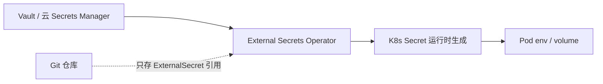

# 密钥与配置治理(Phase 0)

> 所属:商业级演化详细设计(阶段 0–2)。总览见 [README](README.md)。

### 2.1 方案

- `k8s/secret.yaml` 删除并替换为 `externalsecret.yaml`(只含 key 引用);`kustomization.yaml` 同步修改。
- **立即动作**:轮换 `DB_PASSWORD`、`REDIS_PASSWORD`、`APP_JWT_SECRET`;用 `git filter-repo` 清理历史;CI 加 gitleaks。
- JWT:HS256 → **RS256/EdDSA + JWKS**(私钥仅在 auth 服务,其余服务只持公钥),支持 `kid` 轮换。

### 2.2 配置校验
- 新增 `ProdConfigGuard`(`@Profile("prod")`,`ApplicationRunner`):启动时校验 JWT 密钥非空且长度合规、`FLYWAY_ENABLED` 与迁移版本一致、`app.security.enabled=true`,否则**拒绝启动**。
- Kafka:`trusted.packages` 改为明确包名;改用 `ErrorHandlingDeserializer` + 显式事件类型头,拒绝 `*`。

