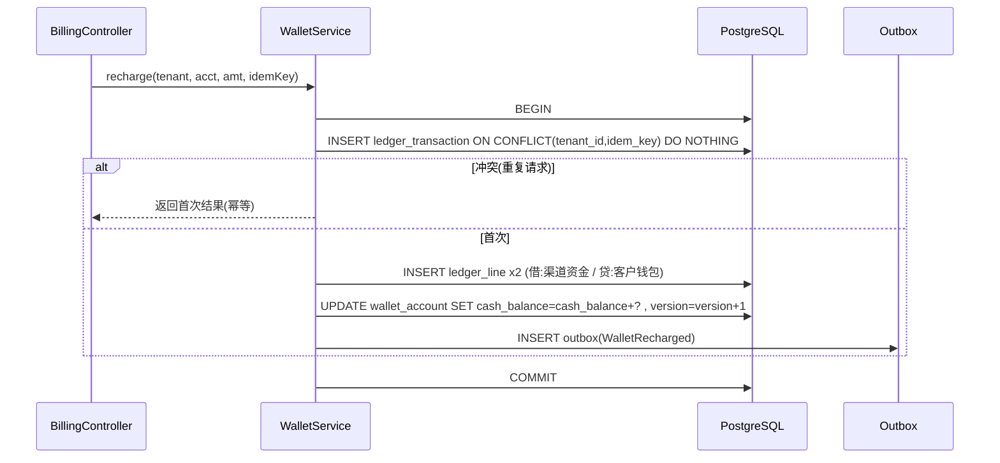

# 账本与资金(Phase 1,核心)

> 所属:商业级演化详细设计(阶段 0–2)。总览见 [README](README.md)。


### 5.1 数据模型(新 Flyway `V23`,expand 阶段)
```sql
-- 不可变分录:只追加,冲正用反向分录
CREATE TABLE ledger_transaction (
  id            uuid PRIMARY KEY,
  tenant_id     varchar(64) NOT NULL,
  idem_key      varchar(128) NOT NULL,
  type          varchar(32)  NOT NULL,   -- RECHARGE, SPEND, FREEZE, RELEASE, PAYOUT, REVERSAL, ADJUST
  reverses_id   uuid NULL REFERENCES ledger_transaction(id),
  status        varchar(16)  NOT NULL,   -- POSTED
  created_at    timestamptz  NOT NULL DEFAULT now(),
  created_by    varchar(64)  NOT NULL,
  UNIQUE (tenant_id, idem_key)
);
CREATE TABLE ledger_line (
  id            bigserial PRIMARY KEY,
  txn_id        uuid NOT NULL REFERENCES ledger_transaction(id),
  tenant_id     varchar(64) NOT NULL,
  account_id    varchar(64) NOT NULL,
  direction     char(1) NOT NULL CHECK (direction IN ('D','C')),
  amount        numeric(20,6) NOT NULL CHECK (amount > 0),
  currency      char(3) NOT NULL,
  created_at    timestamptz NOT NULL DEFAULT now()
);
-- 每笔交易借贷平衡:延迟约束触发器(提交时校验 SUM(D)=SUM(C) 按币种)
-- 禁止 UPDATE/DELETE:REVOKE + BEFORE UPDATE/DELETE 触发器 RAISE EXCEPTION
CREATE TABLE ledger_balance_snapshot (  -- 对账用日终快照
  account_id varchar(64), snap_date date, balance numeric(20,6), PRIMARY KEY(account_id, snap_date));
```
- `wallet_account.cash_balance` 保留为**物化余额**,与账本由同一事务更新;日终对账任务校验 `SUM(ledger_line) == wallet_account`。
- 与现有 `billing_entry` 的迁移:双写 → 回填 → 读切换 → 停旧写(expand/contract,见 §9)。

### 5.2 记账流程(以充值为例)

改动要点:
- **先插入幂等行再动余额**(靠唯一约束消除 check-then-act 竞态),取代"先 `findByIdempotencyKey`"。
- 去掉 `Striped<Lock>` 作为正确性依赖(仅可留作减少热点冲突的优化);余额用 SQL 条件更新:`SET frozen = frozen + ? WHERE cash_balance - frozen + credit_limit >= ?`,影响行数=0 即余额不足。
- `tenantId` 必须由上下文传入,删除 `"public"` 硬编码。
- 预占(FREEZE/RELEASE)同样写分录;预占带 `expires_at`,过期由任务自动释放。

### 5.3 对账与冲正
| 任务 | 频率 | 检查 | 失败处理 |
|---|---|---|---|
| 账内对账 | 每日 + 每小时增量 | 每笔交易借贷平衡;`SUM(lines)=wallet` | P1 告警 + 冻结账户写入 |
| 渠道对账 | 每日 | 支付渠道/打款回单 vs `PAYOUT` 分录 | 差异单进人工工作台 |
| 转化对账 | 每日 | 转化事实(ClickHouse)vs 结算佣金分录 | 补账/冲正单 |
- 冲正 API:`POST /api/v1/billing/transactions/{id}/reverse`,需 `ledger:reverse` + 原因 + 四眼审批,生成 `REVERSAL` 分录。

### 5.4 打款批次(`MassPayoutBatchService`)
状态机:`DRAFT → SUBMITTED → APPROVED → PROCESSING → (PAID | PARTIAL | FAILED)`;每个状态迁移写审计、带幂等键;渠道回调幂等;失败项自动生成释放分录。

