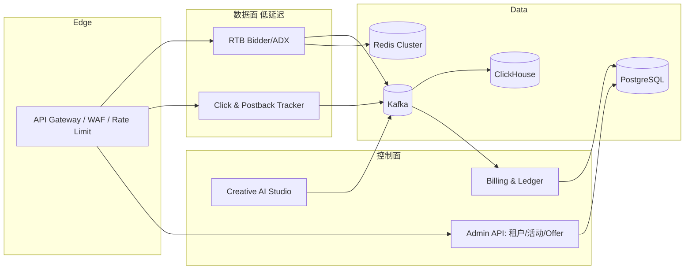

# Affiliate Platform 项目分析与商业级演化方案

> 依据:目录/POM/CI/K8s/配置/文档及代码静态扫描。**未运行完整构建与测试,性能数据取自项目自带文档,未经我复验。**

## 1. 现状画像

| 维度 | 观察 |
|---|---|
| 技术栈 | Java 21 / Spring Boot 3.4.3 / MyBatis-Plus / PostgreSQL + Flyway(V1~V22) / Redis(Redisson) / Kafka / ClickHouse / Nuxt 3 |
| 规模 | 19 个后端模块 + 前端;约 88 实体/表;最大模块:infrastructure(148 文件)、creative(140)、affiliate(94) |
| 业务面 | 网盟(Offer/SmartLink/LinUCB/SKAN/S2S/反作弊)+ DSP/SSP/ADX(OpenRTB 2.5)+ DMP/CDP + 预算 + 计费 + AI 创意(视频生成/混剪/质检) |
| 交付 | GitHub Actions CI/CD、K8s(数据面/控制面拆分、HPA、PDB)、Grafana 看板、k6 压测 |
| 文档 | 非常丰富(架构、迁移、运维、路线图) |

**定位判断**:能力广度已接近"全栈广告科技平台",但处于"功能完备的技术样板 → 可收费商业产品"之间。主要差距不在功能,而在**深度、安全、可信度与运营化**。

## 2. 核心风险(按严重度)

### P0 — 上线前必须解决
1. **密钥入库**:`k8s/secret.yaml` 明文含 DB/Redis 密码与 JWT secret。需立即轮换并改用 External Secrets / Vault / Sealed Secrets,并清理 git 历史。
2. **授权覆盖极低**:全后端仅约 1 处 `@PreAuthorize/hasRole`,而项目含资金(billing/wallet/payout)与跨租户能力。需统一 RBAC + 租户强制过滤(MyBatis-Plus TenantLineInterceptor 已有依赖,应全表覆盖并加测试)。
3. **财务一致性**:钱包/打款/分成需要不可变复式账本、幂等键、对账任务、审计日志;`@Transactional` 仅出现在 16 个文件,边界需系统审查。
4. **单模块过度耦合风险**:`platform-api` 把所有模块装配为一个应用(再用 profile 拆数据面/控制面),RTB 热路径与后台任务共享依赖与发布节奏。

### P1 — 商业可信度
5. **内存态残留**:77 个文件使用 `ConcurrentHashMap`,25 个文件含 simulate/mock/模拟(如 `GeolocationService`、`ParquetUserProfileReader`、`LinUcbBanditEngine`、`OfferSupplementService`)。需逐个确认:是真缓存、测试替身、还是未接真实依赖的伪实现。
6. **性能数据可信度**:"RTB P99 < 0.2ms"是进程内撮合基准,不含网络、序列化、Redis 预算扣减、竞价方 fan-out。商业 SLA 需端到端压测(目标 p99 < 80ms)。
7. **测试不均衡**:`platform-api` 仅 1 个测试;缺少集成测试(Testcontainers: PG/Redis/Kafka)、契约测试、多租户隔离测试、资金对账测试。前端无测试。
8. **反欺诈/归因算法无离线验证**:LinUCB、Data-Driven MTA、4D 反作弊缺少回放评估与 A/B 基线。
9. **第三方集成深度**:Google Ads/GAM、AI 视频供应商(DashScope/Ark)缺少熔断、限流、配额、成本熔断与重试策略的统一治理(仅 10 个文件使用 HTTP 客户端)。

### P2 — 工程与合规
10. 仓库含 `target/`、`.idea/`;CI 仅 build + k8s 校验,缺依赖漏洞扫描(OWASP/Trivy)、SAST、SBOM、镜像签名。
11. 合规缺口:GDPR/CCPA/PIPL(同意管理 CMP、数据主体请求、数据留存)、IAB TCF、ads.txt/sellers.json/schain、ATT/SKAN 合规。
12. 文档自述"100% 落地/零占位"属过度承诺,应以自动化验收(覆盖率、E2E 清单)代替。

## 3. 目标架构

要点:将 `platform-api` 拆成**独立可部署单元**(tracker、rtb、admin、worker/creative),共享 `common/infrastructure`;数据面无状态、只依赖 Redis/Kafka;账务与报表走事件流 + 对账。

## 4. 分阶段路线图

### 阶段 0(第 1–2 周):安全与底线
- 轮换所有已泄露密钥;接入 Vault/External Secrets;git 历史清理;`.gitignore` 补 `target/`、`.idea/`。
- 全接口权限矩阵(角色 × 资源 × 动作)+ 注解/AOP 强制;跨租户越权自动化测试。
- CI 增加:JaCoCo 覆盖率门禁、Trivy、OWASP dependency-check、gitleaks、Checkstyle/SpotBugs。
- 盘点 77 处 `ConcurrentHashMap` 与 25 处 mock/simulate,输出"真实/替身/待替换"清单并建 backlog。

### 阶段 1(第 3–6 周):资金与数据正确性
- 复式账本不可变化(只追加 + 冲正),所有资金操作带幂等键;日终对账(账本 vs 钱包 vs 打款 vs 渠道)。
- 转化链路:Kafka 精确一次语义(事务 outbox + 幂等消费者),死信队列与重放工具。
- Testcontainers 集成测试套件(PG/Redis/Kafka/ClickHouse);归因与计费金标准数据集回归。
- Flyway:迁移回滚策略、零停机变更规范(expand/contract)。

### 阶段 2(第 7–12 周):服务拆分与可靠性
- 拆分部署:tracker / rtb / admin / worker 四个镜像,独立 HPA 与 SLO。
- 全外部调用统一 Resilience4j(超时、熔断、舱壁、重试)+ 成本/配额护栏(AI 供应商、Google API)。
- 端到端压测(k6 + 真实依赖):RTB p99、tracker QPS、postback 丢失率;容量模型文档化。
- 可观测:SLO 告警(错误预算)、分布式追踪采样、业务指标(fill rate、EPC、拒绝率)。
- 灾备:PG 主从/PITR、Redis Cluster、Kafka 多副本,演练 RPO/RTO。

### 阶段 3(第 3–6 个月):商业化与合规
- **计量计费(SaaS 化)**:套餐、用量计费(点击/曝光/AI 调用)、发票、对账导出、租户级配额。
- 合规:CMP/TCF 2.2、数据主体请求(导出/删除)、PII 加密与字段级脱敏、审计不可篡改、ads.txt/sellers.json/schain。
- 反欺诈产品化:规则 + 模型双引擎、离线回放评估、误杀率/漏杀率看板、人工复核工作台。
- 开放平台:公开 API、OpenAPI 文档、Webhook、SDK(多语言)、沙箱环境、API Key 限流与用量。

### 阶段 4(6–12 个月):智能化与生态
- 竞价与归因:出价模型(pCTR/pCVR)特征平台 + 在线/离线一致性;MMM/增量实验;LinUCB → 上下文深度模型并保留 bandit 兜底。
- 创意闭环:素材表现回流 → 自动生成/淘汰;品牌安全与版权校验。
- 生态集成:Meta/TikTok/Google/AppsFlyer/Adjust 连接器市场;多区域部署与数据驻留。

## 5. 验收指标(替代"100% 落地"表述)

| 类别 | 指标 |
|---|---|
| 安全 | 0 明文密钥;越权测试通过率 100%;高危漏洞 0 |
| 质量 | 核心模块行覆盖 ≥70%,资金/归因 ≥85%;集成测试进 CI |
| 性能 | RTB 端到端 p99 < 80ms;tracker 点击 p99 < 50ms;postback 丢失率 < 0.01% |
| 可靠性 | 可用性 99.95%;RPO ≤ 5min;RTO ≤ 30min(已演练) |
| 财务 | 日对账差异 = 0;所有账务操作可审计、可冲正 |

## 6. 建议下一步

1. 先做阶段 0 的密钥与授权审计(我可直接动手产出权限矩阵与修复 PR)。
2. 跑一次完整 `mvn verify`,基于真实结果修正本报告的风险排序。
3. 确认商业模式(自营网盟 / SaaS 多租户 / 程序化交易)——决定阶段 3 的优先级。
