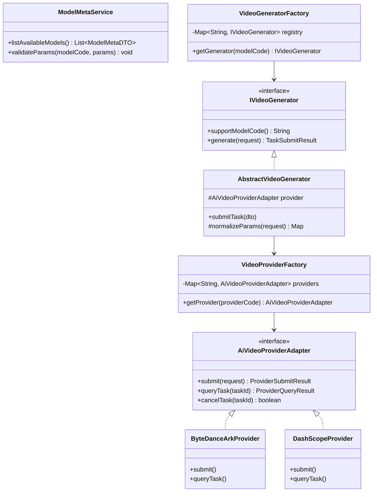
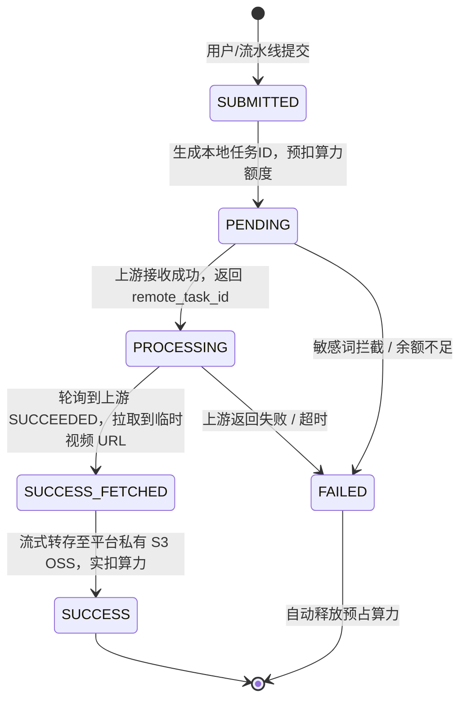

# 01 - AI 视频多模型引擎：架构设计与实现规范

## 1. 设计背景与核心痛点

在现代广告素材自动化生产中，市面上的主流视频生成大模型（如字节跳动火山引擎 Seedance 2.0、阿里百炼 DashScope Wan 2.1 / HappyHorse、Google Veo、开源 ComfyUI 等）具有高度异构性：
1. **厂商接口协议各异**：鉴权方式包含 Bearer Token、AWS-like HMAC-SHA256 签名、临时 STS 凭据；请求格式包含 JSON RPC、RESTful POST、轮询与 Webhook 混用。
2. **模型业务语义不同**：同属 DashScope 的模型，文生视频仅需 `prompt`，图生视频需 `startImageUrl`，参考生视频需多张图片和特定语法，视频编辑则必须输入原视频 `sourceVideoUrl`。
3. **前后端强耦合**：早期每接入一个新模型，前后端都需要硬编码改动表单字段、增加参数校验逻辑，维护成本随模型数量急剧膨胀。

为解决以上痛点，本系统完全复用并演进的经典三层解耦架构：
$$\text{Controller} \longrightarrow \text{Model Meta (元数据驱动)} \longrightarrow \text{Generator (业务语义层)} \longrightarrow \text{Provider Adapter (厂商协议层)}$$

---

## 2. 总体类图与架构分层



### 职责边界定义

| 层级 | 核心职责 | 不关心的事项 |
|---|---|---|
| **Model Meta 层** | 对外描述模型能力、支持的宽高比、分辨率枚举、运镜选项、单价与计费规则，驱动前端动态渲染表单 | 不关心如何调厂商 API，不关心业务订单状态 |
| **Generator 层** | 以**模型业务语义**为中心。负责校验业务入参、提示词拼装、图文引用解析、默认参数注入，构造厂商所需的 Payload | 不关心底层 HTTP 鉴权签名算法、网络重试与轮询调度 |
| **Provider Adapter 层** | 以**厂商云服务**为中心。负责 HTTP Header 组装、HMAC/Bearer 鉴权签名、异步提交、远程任务查询、上游错误码转本地标准异常 | 不理解文生视频还是图生视频的业务语义，只处理原子协议交互 |

---

## 3. 动态模型元数据设计 (Model Meta)

每个模型在 `creative_ai_model_meta` 表中均有一条元数据配置。前端通过 `GET /api/v1/creative/ai/models` 获取模型元数据后，利用 JSON Schema 自动渲染参数表单。

### 元数据 DTO 结构
```json
{
  "modelCode": "ark_seedance_2_0",
  "modelName": "字节跳动 Seedance 2.0 (高清画质)",
  "providerCode": "BYTEDANCE_ARK",
  "supportedTypes": ["TEXT_TO_VIDEO", "IMAGE_TO_VIDEO", "REFERENCE_TO_VIDEO"],
  "billingUnit": "SECOND",
  "unitPrice": 0.1500,
  "pricingMultiplier": 1.0,
  "fieldSchema": {
    "aspectRatio": {
      "type": "select",
      "label": "视频画幅比例",
      "options": [
        {"label": "竖屏 9:16 (推荐短视频)", "value": "9:16", "isDefault": true},
        {"label": "横屏 16:9", "value": "16:9"},
        {"label": "正方形 1:1", "value": "1:1"}
      ],
      "required": true
    },
    "durationSeconds": {
      "type": "select",
      "label": "生成时长",
      "options": [
        {"label": "5 秒 (标准)", "value": 5, "isDefault": true},
        {"label": "10 秒 (长镜头)", "value": 10}
      ],
      "required": true
    },
    "motionStrength": {
      "type": "select",
      "label": "动作幅度",
      "options": [
        {"label": "轻微动作 (微动态/平移)", "value": "low"},
        {"label": "标准动作 (走动/表情丰富)", "value": "medium", "isDefault": true},
        {"label": "剧烈动作 (快节奏/运镜切换)", "value": "high"}
      ],
      "required": false
    },
    "cameraMotion": {
      "type": "select",
      "label": "镜头运镜",
      "options": [
        {"label": "自动", "value": "auto", "isDefault": true},
        {"label": "推近 (Zoom In)", "value": "zoom_in"},
        {"label": "拉远 (Zoom Out)", "value": "zoom_out"},
        {"label": "右环绕 (Pan Right)", "value": "pan_right"}
      ],
      "required": false
    }
  }
}
```

---

## 4. 统一异步任务生命周期与流式转存

### 4.1 任务状态流转图


### 4.2 双重转存机制 (Upstream Raw URL $\to$ S3 OSS)
- **背景**：上游厂商（如阿里百炼、火山引擎）生成的视频下载链接通常具有**时效性**（有效期通常仅为 24 小时），过期后链接永久失效。
- **实现方案**：
  1. 轮询线程发现上游返回 `SUCCEEDED` 状态后，先将任务标记为中间状态 `SUCCESS_FETCHED`，保存临时链接至 `raw_output_url`。
  2. 立即启动基于管道流的异步转存服务（`StreamingOssTransferService`），通过 HTTP GET 获取视频流，一边下载一边直传上传到租户私有 S3 / MinIO 对象存储。
  3. 转存完毕后，将永久有效的新 CDN 地址写入 `oss_url`，更新任务为终态 `SUCCESS`。若转存过程发生异常，支持 3 次幂等重试，防止物料丢失。

---

## 5. Java 21 虚拟线程在异步轮询中的实战

AI 视频生成属于典型的“长耗时、高 I/O 阻塞、低 CPU 负载”场景，单任务轮询耗时在 30 秒至 3 分钟不等。
传统线程池（如 200 个平台线程）在面对 500 个并发生成任务时会直接耗尽线程，导致所有请求排队、甚至引发整个 Spring Boot 容器雪崩。

本系统采用 Java 21 虚拟线程作为轮询与状态拉取的核心执行器：
```java
@Configuration
public class AiTaskExecutorConfig {

    @Bean(name = "aiVideoPollingExecutor")
    public ExecutorService aiVideoPollingExecutor() {
        // 创建无界虚拟线程池，针对 I/O 阻塞自动休眠与挂起
        return Executors.newVirtualThreadPerTaskExecutor();
    }
}
```
轮询 Worker 每 15 秒扫描一次 `PROCESSING` 状态的任务，为每个任务派发一个独立的虚拟线程发起 HTTP 请求并处理结果。即使并发轮询 5000+ 个任务，单节点内存占用仅增加数兆字节，彻底解除并发瓶颈。
