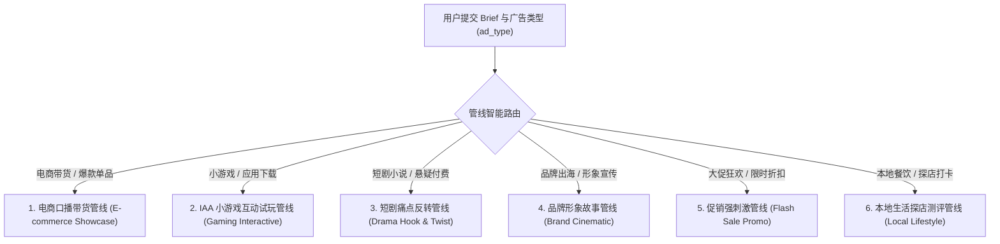
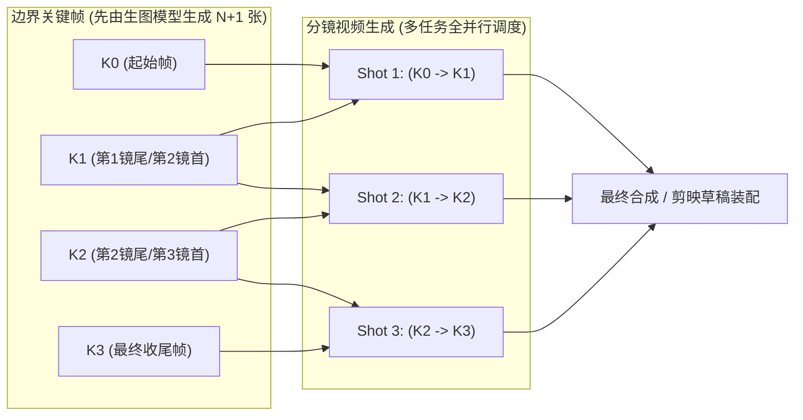
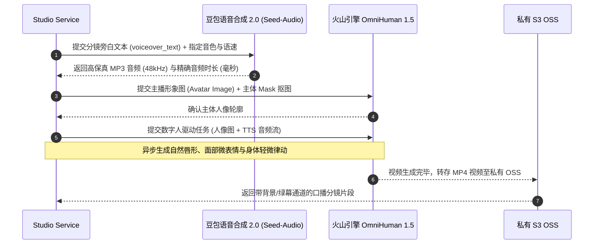

# 02 - AI 长视频工作台流水线与剪映草稿协议导出

## 1. 业务目标与工程定位

当前市面上绝大部分消费级与商业级视频大模型（Seedance、Wan、Kling、Veo）仅支持生成单段 3~10 秒短视频，直接让大模型单次生成 1~2 分钟连续长视频在当今技术条件下不仅连贯性极差，而且生成失败率高达 80% 以上。

AI 长视频工作台（Long Video Studio）的目标是建立一条**工程化确定的自动生产流水线**：
> 用户输入创意文案（Brief） $\longrightarrow$ AI 拆解角色/产品 $\longrightarrow$ 生成素材图 $\longrightarrow$ 生成分镜脚本 $\longrightarrow$ 边界关键帧法逐镜生成视频 $\longrightarrow$ 导出剪映草稿工程或本地 FFmpeg 混流成片。

---

## 2. 七大工程流水线阶段

```
用户操作                          后端执行流程                                数据库状态流转
───────                          ────────                                ────────────────
① 创建项目                        POST /projects                         creative_studio_project: draft
   设置标题/brief/比例/时长/渠道                                          
   
② 角色/产品资产拆解                POST /{id}/assets/prompts               creative_studio_asset: draft
   LLM 解析出角色/商品及生图Prompt  (异步调用 LLM 结构化提取)               task_record: ASSET_ANALYSIS

③ 批量生成资产图片                POST /{id}/assets/generate-images       creative_studio_asset: generated
   调用 Flux/SD 渲染角色商品白底图 (异步生图并转存私有 OSS)                 task_record: IMAGE_GENERATION

④ 6管线分镜脚本规划               POST /scenes/storyboards/generate       creative_studio_scene: 批量写入
   依据渠道与行业自动分流分镜Prompt (LLM 输出分镜时长/运镜/旁白/台词/收尾画面)   task_record: STORYBOARD

⑤ 边界关键帧与视频生成            POST /scenes/{sceneId}/generate          scene: generating -> generated
   边界关键帧驱动 (Ki -> Ki+1)     (提交到 Seedance/Wan，生成视频片段)       task_record: PENDING -> PROCESSING

⑥ 虚拟线程后台扫描与级联同步        Scheduled Polling Worker (15s)          task_record: SUCCESS
   拉取上游片段并转存 OSS           级联更新 scene.video_clip_url            scene: generated

⑦ 导出剪映草稿或本地混流          POST /{id}/export-capcut                project: completed
   按时间轴组装多轨道草稿包        调用 CapCut-Mate 生成草稿链接             生成 draft_url /成片 MP4
```

---

## 3. 六套行业分镜提示词管线 (Prompt Pipelines)

系统在 `StoryboardPipelineService` 中内置 6 套行业管线，针对不同广告投放诉求进行精准提示词分流：



### 提示词结构与输出格式规范 (`RESPONSE_FORMAT_CN`)
LLM 必须输出严格符合如下 JSON 结构的内容：
```json
{
  "scenes": [
    {
      "scene_index": 1,
      "prompt": "特写镜头，一个疲惫的年轻白领女性揉着太阳穴，办公桌上堆满文件，冷色调荧光灯光。镜头缓慢推近。收尾画面：女性猛然抬头，眼神中闪烁出惊喜与好奇。",
      "voiceover_text": "天天熬夜加班，头发大把大把掉？",
      "voiceover_tone": "温暖女声",
      "voiceover_speed": "normal",
      "subtitle_text": "天天熬夜加班？脱发太严重！",
      "subtitle_keywords": ["熬夜", "脱发"],
      "duration_seconds": 5,
      "bgm_cue": "轻电子流行 BPM110 从舒缓低沉逐渐走向高潮",
      "transition_type": "chain_extend",
      "transition_desc": "上一镜收尾画面作为本镜起始输入，角色动作连续延展"
    }
  ]
}
```

#### 关键约束规则
1. **单镜时长约束**：`duration_seconds` 必须介于 **3 ~ 15 秒** 之间（底层视频生成模型无法支持小于 3 秒的生成）。
2. **黄金 3 秒 Hook**：第 1 镜头至少用满 3 秒进行强视觉冲击或痛点抛出，不得压缩为 2 秒。
3. **收尾画面强制规范**：Prompt 字符串末尾必须包含明确的**「收尾画面：xxx」**，精确定义该镜头最后一帧的画面细节，用于指导边界关键帧提取。
4. **旁白与字幕分离**：`voiceover_text` 必须是纯可朗读文案，禁止带有“旁白：”或心理描写等前缀；`subtitle_text` 每行长度限制在 15 字以内，`subtitle_keywords` 标记需在剪映中高亮变色的关键词。

---

## 4. 边界关键帧法 (Boundary Keyframe Method)

长视频由多个镜头连接而成。行业常见有“上一镜尾帧驱动下一镜首帧”的串行方案，但该方案有致命缺陷：**若第 2 镜生成失败，后续所有镜头全部阻塞无法执行**。

本系统采用创新的**“边界关键帧法”**：



### 核心收益
1. **全链路高并发**：$N$ 个镜头可同时派发至多个 GPU 节点并发生成，整体时长从 $\sum T_i$ 缩减为 $\max(T_i)$。
2. **片段级故障隔离**：某镜头若因画面畸变或上游超时失败，仅需重新生成该分镜片段，无需推倒重来。

---

## 5. 数字人驱动与多模态语音克隆体系

对于口播带货类广告，长视频工作台支持一键切换为“数字人驱动模式”：



---

## 6. 剪映草稿协议 (CapCut Draft) 微秒级导出实现

为了支持设计师在剪映桌面端/手机端进行精细化二次创作，后端通过 `CapCutMateClient` 组装符合 CapCut 规范的 `draft_content.json` 工程文件：

### 时间轴游标推进算法 (微秒精度)
CapCut 时间轴内部采用微秒（Microseconds, $10^{-6}\text{s}$）作为标准计量单位：
```java
public String addVideosToDraft(String draftUrl, List<AiStudioSceneEntity> scenes) {
    String url = endpoint("add_videos");
    JSONArray videoInfos = new JSONArray();
    long cursorUs = 0L; // 时间轴全局微秒游标

    for (AiStudioSceneEntity scene : scenes) {
        long durationUs = (long) (scene.getDurationSeconds() * 1_000_000L);
        JSONObject info = new JSONObject();
        info.set("video_url", scene.getVideoClipUrl());
        info.set("start", cursorUs);
        info.set("end", cursorUs + durationUs);
        info.set("duration", durationUs);
        info.set("volume", 1.0);
        videoInfos.add(info);
        cursorUs += durationUs; // 推进时间轴游标
    }
    // 发起 HTTP 请求装配剪映草稿视频轨
    return executeAddVideos(draftUrl, videoInfos);
}
```

### 多轨道自动合成矩阵
导出的剪映草稿包含 4 条标准对齐轨道：
- **Track 1（主视频轨）**：按序号依次拼接的各分镜视频片段。
- **Track 2（配音轨）**：豆包 TTS 生成的分镜旁白音频（MP3），音画严格对齐。
- **Track 3（背景音乐轨 BGM）**：依据分镜中 `bgm_cue` 检索到的版权音乐，自动在片头片尾做 1.5 秒音量渐强与淡出。
- **Track 4（智能花字字幕轨）**：将 `subtitle_text` 渲染为字幕切片，并在 `subtitle_keywords` 词条处应用加粗、描边与荧光黄色高亮。
