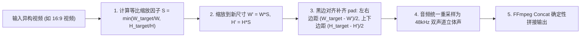
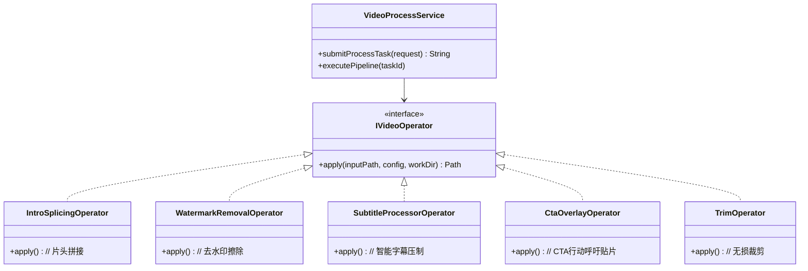

# 03 - 视频智能剪辑与混剪中心：算法与工程实现

## 1. 业务目标与核心原则

现代效果广告投放需要持续批量生产物料变体以对抗素材衰退。例如将 AI 生成的高吸引力片头（Hook 片头，3~5秒）与素材库中经过市场验证的高转化实拍片段（Gameplay / 真实体验，15~30秒）进行物理硬拼接，即可低成本衍生出“千稿千面”的测试素材。

视频智能剪辑中心的核心定位是：**“确定性物理拼接 + 画幅对齐”的高效合成引擎**。

### 核心设计原则
1. **纯物理操作，拒绝不可控的语义重写**：只做两段或多段视频的确定性无损拼接，不做不可预测的智能跳帧或内容重构。
2. **画幅对齐是核心刚需**：不同来源的视频分辨率各异（AI 片头常为 9:16 竖屏，素材库可能为 16:9 横屏或 1:1 方屏）。直接拼接会导致播放器严重变形或拉伸，必须在拼接前进行统一画幅裁决与黑边自适应对齐。

---

## 2. 媒体探针服务 (MediaProbe)

在执行任何剪辑、转码或拼接前，系统首先通过 `MediaProbeService` 调用底层 `FFprobe` / `JavaCV` 提取视频元数据：

```java
public record VideoProbeResult(
    int width,                    // 视频宽度像素 (如 1080)
    int height,                   // 视频高度像素 (如 1920)
    String aspectRatio,           // 比例字符串 (如 "9:16")
    double durationSeconds,       // 时长秒数 (微秒高精换算)
    double fps,                   // 视频帧率 (如 30.0 / 29.97)
    String videoCodec,            // 编码格式 (h264 / hevc)
    int videoBitrate,             // 码率 (bps)
    boolean hasAudio,             // 是否包含音频轨
    String audioCodec,            // 音频编码 (aac / mp3)
    int audioSampleRate,          // 音频采样率 (如 48000 / 44100)
    int audioChannels             // 音频声道数 (1: 单声道, 2: 双声道立体声)
) {}
```

探针结果作为后续滤镜构建的唯一事实依据，坚决避免硬编码 `25fps` 或 `44100Hz` 导致的时长拉伸或音画不同步。

---

## 3. 画幅自适应对齐与确定性硬拼接 (Auto-Stitch)

当将片头视频 $V_1$（如 $1080 \times 1920$, 9:16）与主体视频 $V_2$（如 $1920 \times 1080$, 16:9）拼接为目标 $1080 \times 1920$ 视频时，执行以下标准化数学变换：



### 核心对齐滤镜公式 (FFmpeg Filter)
```text
scale=1080:1920:force_original_aspect_ratio=decrease,pad=1080:1920:(ow-iw)/2:(oh-ih)/2:black
```
- 若输入视频比例偏宽：上下保留原始画幅，左右或上下自动填充纯黑背景（Letterbox/Pillarbox），保证原始物料不被压扁或拉长。
- 若两段视频分辨率与帧率完全一致，系统自动走 `-c copy` 极速流复用通道，在 0.5 秒内完成无损拼接。

---

## 4. 五大原子后处理算子实战实现



### 4.1 去水印算子 (Watermark Removal)
针对素材库或竞品视频中残留的台标、时间戳或平台水印：
- 用户在后台界面拖拽指定矩形选区 `(x, y, w, h)`。
- 底层应用基于 OpenCV Navier-Stokes 与 FFmpeg Delogo 算法：
  ```bash
  ffmpeg -i input.mp4 -vf "delogo=x=850:y=30:w=200:h=80:show=0" -c:a copy output.mp4
  ```
  通过对周围像素进行三次样条差值，实现水印区域平滑虚化擦除。

### 4.2 智能字幕算子 (Subtitle Processor)
- **ASR 识别**：若视频未带字幕，先调用快速 ASR 提取语音时间戳生成标准 `.srt`。
- **Libass 硬压制**：通过高级样式格式（ASS）指定黑金描边、大字号与动态高亮：
  ```bash
  ffmpeg -i input.mp4 -vf "subtitles=sub.srt:force_style='Fontname=SourceHanSansCN-Bold,FontSize=22,PrimaryColour=&H00FFFFFF,OutlineColour=&H00000000,Outline=2'" -c:a copy output.mp4
  ```

### 4.3 片头注入算子 (Intro Hook Splicing)
在广告前 2~3 秒插入抓人眼球的 Hook 片头视频或动态 GIF，通过精确重编码保证两个视频切片之间的转场在 1 帧内完成切换，无黑屏卡顿。

### 4.4 CTA 行动呼吁动效贴片 (CTA Overlay)
在视频收尾前 3.5 秒叠加“点击立即下载 / 免费领取体验”浮层，并带 0.5 秒淡入效果：
```bash
ffmpeg -i main.mp4 -i cta_button.png -filter_complex "[1:v]format=rgba,fade=in:st=26.5:d=0.5:alpha=1[cta];[0:v][cta]overlay=(W-w)/2:H-h-120:enable='gte(t,26.5)'" -c:a copy output.mp4
```

### 4.5 分段无损裁剪 (Trim)
去除原始实拍片段冗长的结尾，精准到毫秒级的快速裁剪：
```bash
ffmpeg -ss 00:00:03.200 -to 00:00:25.800 -i input.mp4 -c copy output.mp4
```

---

## 5. 定时批量混剪调度器 (Auto Stitch Scheduler)

系统在 `creative_auto_stitch_config` 表中定义批量混剪任务：
- **笛卡尔积交叉组合**：
  若片头文件夹中包含 5 个 AI Hook 片头（$H_1 \sim H_5$），主体文件夹包含 10 个实拍片段（$B_1 \sim B_{10}$），系统一键生成 $5 \times 10 = 50$ 组排列组合混剪任务。
- **定时触发与单次幂等**：由 `VideoEditAutoStitchScheduler` 按设定时间精准触发，任务提交至 Redis 任务队列后将状态流转为 `EXECUTED`，防止重复消费。

---

## 6. 磁盘空间高水位防御与生命周期管理

由于多媒体转码会在本地磁盘产生庞大的临时切片，系统构建了严密的存储防护体系：
1. **沙箱隔离目录**：每个转码任务创建独立目录 `/tmp/creative_transcode/{task_no}/`。
2. **任务结束即销毁**：业务执行包裹在 `try-finally` 中，无论任务成功、失败还是被主动取消，均执行 `FileSystemUtils.deleteRecursively(...)`。
3. **后台守护保洁任务**：每 30 分钟扫描一次本地工作区，强行清理由进程崩溃或 OOM 导致的超过 2 小时的孤儿临时文件。
4. **高水位自保熔断**：探针定时检测宿主机磁盘使用率，一旦超过 **80%**，立即熔断暂停接收新混剪任务并向钉钉/企业微信群发送警报。
