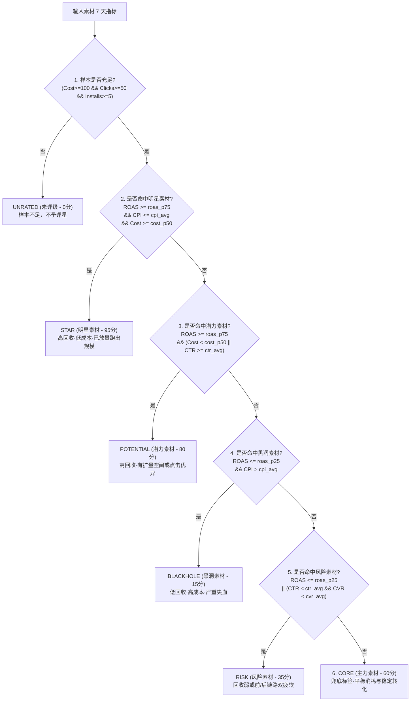

# 04 - 素材效果数据打标与动态基准线系统

## 1. 业务目标与设计哲学

在广告投放业务中，“ROAS 多少算高、CPI 多少算好”绝不能靠产品经理或运营人员凭空主观拍脑袋。市场的平均水准每时每刻都在随着大盘买量竞争、季节性波动（如黑五、圣诞大促）而动态剧烈变化。

> **基准不是凭空定的，而是从全平台近 7 天所有素材的真实投放事实中反推出来的；判定线每天凌晨动态重算并自动浮动，不需要发版改代码。**

---

## 2. 7天动态滑动大盘基准线设计 (`creative_benchmark_7d`)

每天凌晨数仓跑批任务，基于近 7 天历史事实表聚合计算全盘基准：

| 基准字段 | 统计口径 | 业务作用与判定标尺 |
|---|---|---|
| `roas_p75` | 近 7 天全部达标素材 ROAS 的 **75 分位数** | “高回收”及格线（排名前 25% 的高产物料） |
| `roas_p25` | 近 7 天全部达标素材 ROAS 的 **25 分位数** | “低回收”警戒线（排名后 25% 的亏损物料） |
| `cost_p50` | 近 7 天全部达标素材 7 日消耗的 **中位数 (50分位)** | “是否跑出规模”的分界线（区分偶然高表现与规模跑量） |
| `cpi_avg` | 近 7 天全部达标素材的平均转化成本 (CPI/CPA) | “正常成本”的水位线 |
| `ctr_avg` | 近 7 天全部达标素材的平均点击率 (CTR) | “前链路吸引力”的水位线 |
| `cvr_install_avg` | 近 7 天全部达标素材的平均转化率 (CVR) | “后链路转化能力”的水位线 |

---

## 3. 三重有效样本保护门槛（“一身担两职”）

如果某个新素材 7 天只花了 \$30 产生了 3 个点击和 1 个安装，因偶然性会导致 ROAS 异常高或 CPI 极低。如果将这类碎片小样本统计进去，会直接拉飞大盘基准。

系统设定了严密的**三重样本门槛**：
- `sample_cost_threshold` = **100.00**（7日消耗 $\ge \$100$）
- `sample_click_threshold` = **50**（7日点击 $\ge 50$）
- `sample_install_threshold` = **5**（7日转化 $\ge 5$）

### “一身担两职”的双重核心角色
1. **角色 1（数仓侧基准计算池筛选）**：数仓在计算大盘分位线（$P_{75}, P_{25}, P_{50}$）和均值时，**严格只纳入同时满足这 3 项门槛的素材**，确保标尺的统计学严肃性。
2. **角色 2（业务打标侧样本充足性检验）**：在为素材评级时，任一门槛不满足直接归为 `UNRATED`（未评级），绝不让小样本进入星级评定。

---

## 4. 生产级数仓 ETL 批处理 SQL 脚本

在 PostgreSQL / Hologres 中按如下脚本每天凌晨计算基准线并入库：

```sql
WITH const AS (
    -- 1. 定义三重样本门槛常量
    SELECT  CAST(100.00 AS NUMERIC(18,6)) AS sample_cost_threshold,
            CAST(50     AS BIGINT)        AS sample_click_threshold,
            CAST(5      AS BIGINT)        AS sample_install_threshold
),
win AS (
    -- 2. 锁定 7 天动态滑动时间窗口
    SELECT  ('${stat_date}')::DATE      AS stat_date,
            ('${stat_date}')::DATE - 6 AS window_start_date,
            ('${stat_date}')::DATE     AS window_end_date
),
raw AS (
    -- 3. 提取 7 天事实明细数据
    SELECT  a.day,
            a.material_id,
            COALESCE(a.promotion_cost, 0)    AS promotion_cost,
            COALESCE(a.install_num, 0)       AS install_num,
            COALESCE(a.impressions, 0)       AS impressions,
            COALESCE(a.clicks, 0)            AS clicks,
            COALESCE(a.conversion_values, 0) AS conversion_values
    FROM dwd_ad_channel_material_day_fact a
    CROSS JOIN win w
    WHERE a.day::DATE >= w.window_start_date
      AND a.day::DATE <= w.window_end_date
      AND a.material_id IS NOT NULL
),
m AS (
    -- 4. 按素材维度聚合 7 天指标
    SELECT  material_id,
            SUM(promotion_cost)    AS promotion_cost,
            SUM(install_num)       AS install_num,
            SUM(impressions)       AS impressions,
            SUM(clicks)            AS clicks,
            SUM(conversion_values) AS conversion_values
    FROM raw
    GROUP BY material_id
),
m_metric AS (
    -- 5. 计算比率指标，并执行三重门槛过滤
    SELECT  m.*,
            CAST(m.clicks AS NUMERIC(18,6)) / NULLIF(CAST(m.impressions AS NUMERIC(18,6)), 0)         AS ctr,
            CAST(m.install_num AS NUMERIC(18,6)) / NULLIF(CAST(m.clicks AS NUMERIC(18,6)), 0)         AS cvr_install,
            CAST(m.promotion_cost AS NUMERIC(18,6)) / NULLIF(CAST(m.install_num AS NUMERIC(18,6)), 0) AS cpi,
            CAST(m.conversion_values AS NUMERIC(18,6)) / NULLIF(CAST(m.promotion_cost AS NUMERIC(18,6)), 0) AS roas
    FROM m
    CROSS JOIN const c
    WHERE m.promotion_cost >= c.sample_cost_threshold
      AND m.clicks >= c.sample_click_threshold
      AND m.install_num >= c.sample_install_threshold
)
INSERT INTO creative_benchmark_7d (
    id, tenant_id, stat_date, window_start_date, window_end_date,
    material_sample_count, sample_cost_threshold, sample_click_threshold, sample_install_threshold,
    roas_p75, roas_p25, cost_p50, cpi_avg, ctr_avg, cvr_install_avg, created_at
)
SELECT  'bm_' || to_char(w.stat_date, 'YYYYMMDD'),
        'public',
        w.stat_date,
        w.window_start_date,
        w.window_end_date,
        COUNT(1)                                                     AS material_sample_count,
        MAX(c.sample_cost_threshold)                                 AS sample_cost_threshold,
        MAX(c.sample_click_threshold)                                AS sample_click_threshold,
        MAX(c.sample_install_threshold)                              AS sample_install_threshold,
        PERCENTILE_CONT(0.75) WITHIN GROUP (ORDER BY m_metric.roas)  AS roas_p75,
        PERCENTILE_CONT(0.25) WITHIN GROUP (ORDER BY m_metric.roas)  AS roas_p25,
        PERCENTILE_CONT(0.50) WITHIN GROUP (ORDER BY m_metric.promotion_cost) AS cost_p50,
        AVG(m_metric.cpi)                                            AS cpi_avg,
        AVG(m_metric.ctr)                                            AS ctr_avg,
        AVG(m_metric.cvr_install)                                    AS cvr_install_avg,
        NOW()
FROM m_metric
CROSS JOIN win w
CROSS JOIN const c
GROUP BY w.stat_date, w.window_start_date, w.window_end_date;
```

---

## 5. 六级质量标签严格短路状态机

素材质量标签评定按**固定顺序**依次命中，先命中者直接短路返回，不可更改顺序：



### 业务标签规则定义详解

#### 1. `UNRATED` (未评级)
- **触发规则**：`7日消耗 < sample_cost_threshold` 或 `7日点击 < sample_click_threshold` 或 `7日安装 < sample_install_threshold`。
- **业务意义**：样本量不足，可能处于冷启动测新阶段，避免过早误判。

#### 2. `STAR` (明星素材 - 爆款)
- **触发规则**：`ROAS >= roas_p75` 且 `CPI <= cpi_avg` 且 `Cost >= cost_p50`。
- **业务意义**：三项全部达标的高价值素材。既能放量、回收率又处于大盘前 25% 高位，获客成本控制极好。是平台扩量与追加预算的第一选择。

#### 3. `POTENTIAL` (潜力素材)
- **触发规则**：`ROAS >= roas_p75`，且满足（`Cost < cost_p50` 或 `CTR >= ctr_avg`）之一。
- **业务意义**：回收表现优异，但消耗尚未达到中位数，说明素材具有极大放量潜能；或者点击率极高，说明前链路吸引力出众。

#### 4. `BLACKHOLE` (黑洞素材)
- **触发规则**：`ROAS <= roas_p25` 且 `CPI > cpi_avg`。
- **业务意义**：回收垫底且买量成本极高，属于严重亏损的劣质资产，应立即触发熔断并换量。

#### 5. `RISK` (风险素材)
- **触发规则**：`ROAS <= roas_p25`，或者（`CTR < ctr_avg` 且 `CVR < cvr_install_avg`）。
- **业务意义**：虽然未完全达到黑洞的极度恶劣程度，但整体表现疲软，前链路无人点击或后链路转化无力。

#### 6. `CORE` (主力素材)
- **触发规则**：样本充足，但未命中上述 5 类条件的稳定兜底。
- **业务意义**：大盘基本盘物料，表现稳健。

---

## 6. 全量广告名称严格等值匹配改造

为了让中台素材库能无缝挂接 Meta、TikTok、Google 的第三方投放事实，系统推行**标准化命名规范**：
- **规范格式**：`MT_{tenantId}_{date}_{creativeId}_{batchTag}`。
- **等值关联**：数仓在执行指标汇总时，通过 `dwd.ad_name = ods_m_material.name` 执行严格等值匹配。对于匹配成功的广告组事实，直接归因至对应的 `creative.id`，并在每日打标快照表 `creative_quality_tag_history` 中记录打标分值与归因事实，形成闭环反哺。
