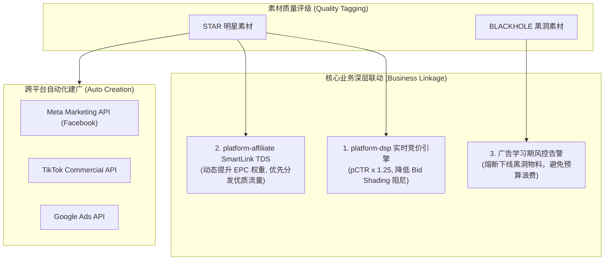

# 05 - 跨平台自动化建广、学习期监控与核心业务赋能

## 1. 业务目标与闭环架构

优质素材生产完毕并被打上质量标签后，如果依然依赖人工在 Meta Ads Manager、TikTok for Business 后台手工建广、上传物料、填写文案与绑定定向，将严重延误爆款素材的投放黄金期。

跨平台自动化建广与学习期监控系统的目标是：
1. **一键跨媒体自动化建广**：系统自动化编排并调用三方 API，批量生成 Campaign $\to$ AdSet $\to$ Ad 投放结构。
2. **广告学习期 (Learning Phase) 监控与熔断**：实时跟踪广告投放前 48 小时的冷启动状态，避免人工频繁调价导致模型震荡，对劣质素材及早熔断。
3. **核心业务深层联动赋能**：将素材质量分直接注入平台内部的 **DSP 实时竞价引擎** 与 **Affiliate SmartLink 智能分流路由**。

---

## 2. 跨媒体 API 自动化批量建广适配器

系统在后端设计策略模式接口 `IPlatformAdService`，屏蔽各海外媒体接口的技术细节差异：

### 2.1 Meta (Facebook Graph API v21+)
- **三层结构自动组装**：
  1. `Campaign`：创建以 `OUTCOME_APP_PROMOTION` 或 `OUTCOME_SALES` 为目标的活动，设置 Advantage Campaign Budget (CBO)。
  2. `AdSet`：配置国家/地区地理定位、年龄段、绑定目标 Pixel ID，设置日预算或竞价上限。
  3. `Ad`：上传本地私有 S3 的视频物料获取 `video_id`，关联主页 Facebook Page ID 与 Instagram Actor ID，组装文案并注入带追踪宏的投放链接。

### 2.2 TikTok Ads Commercial API
- 创建应用推广或网站转化目标活动。
- 绑定 TikTok Pixel 与事件代码（`CompletePayment`, `Install`）。
- 自动开启自动定向扩展与出价策略调整。

---

## 3. 广告学习期 (Learning Phase) 规则与监控体系

每个主流广告平台的算法在广告新上线时都会经历一段“模型探索与学习期”。在此期间模型正在探索受众分布，指标往往具有波动性。如果人为频繁调低出价或暂停，会导致广告彻底“跑死”；但如果任由劣质物料无限制空耗，又会导致巨额买量损失。

### 3.1 学习期业务规则定义
针对 `creative_ad_learning_rule` 配置，系统定义是否处于学习期的判定公式：

$$\text{IsLearning} = \left(\text{FirstMetricTime} \neq \text{null}\right) \land \left(\text{Now} < \text{FirstMetricTime} + \text{TimeDays}\right) \land \left(\text{CumulativeCost} \le \text{CostThreshold}\right)$$

| 条件 | 默认值 | 说明 |
|---|---|---|
| `first_metric_time` | 产生事实时写入 | 首次产生曝光/消耗数据的时间戳；若为空前端展示“未开始” |
| `time_days` | 2 天 (48 小时) | 学习期保护时间窗口 |
| `cost_threshold` | \$50.00 | 学习期测试消耗容忍上限 |

- **当任一条件不再满足时**，系统自动将 `is_learning` 判定为 `0`（度过学习期）。

### 3.2 学习期智能联动与熔断机制
1. **学习期保护模式**：对于处于学习期内的广告，中台系统锁定基础出价，禁止广告优化师频繁调整定向与预算，保护算法探索过程。
2. **黑洞熔断预警**：若广告在学习期内消耗即将触碰门槛，但转化数依然为 0，或者打标引擎将其标记为 `BLACKHOLE`，系统立即触发钉钉/飞书告警，并自动调用三方 API 暂停该广告组，换上推荐的 `STAR` 候选素材。

---

## 4. 与 Affiliate 核心业务链路的深度赋能

素材质量标签不仅用于指导投放人员，更直接作为核心参数注入平台自身的程序化广告系统：

### 4.1 赋能 `platform-dsp` 实时竞价引擎 (RTB Path)
在 RTB 实时竞价微秒级热路径中，DSP 的智能出价模型通过点击率预估（pCTR）和转化率预估（pCVR）计算出价：
$$\text{Bid} = \text{eCPM}_{\text{target}} \times \text{pCTR} \times \text{pCVR} \times \text{QualityMultiplier}$$

- **命中 `STAR`（明星素材）**：
  - 系统自动赋予素材质量增益因子 $\text{QualityMultiplier} = 1.25$。
  - 降低第一价拍卖环境下的 **Bid Shading 阻尼折扣系数**（允许出更高价抢夺顶级媒体广告位），确保爆款素材在 ADX/SSP 竞价中胜出。
- **命中 `BLACKHOLE` / `RISK`（劣质素材）**：
  - $\text{QualityMultiplier}$ 衰减至 $0.5$ 或直接设置 `active = false` 剔除出竞价候选池，从源头止血。

### 4.2 赋能 `platform-affiliate` 网盟 TDS / SmartLink 智能路由
网盟营销中，SmartLink 统一链接需要根据各落地页 Offer 的综合盈利能力（EPC: Earnings Per Click）将流量重定向至最优广告主落地页：
- TDS 智能分流引擎将素材评级纳入路由评分函数：
  $$\text{RoutingScore} = \text{EPC}_{\text{history}} \times \text{CapFactor} \times \left(1 + 0.3 \times \mathbb{I}_{\text{isStar}}\right)$$
- 拥有 `STAR` 素材的推广计划将获得优先流量分配权，帮助网盟平台整体收入和毛利率最大化。
