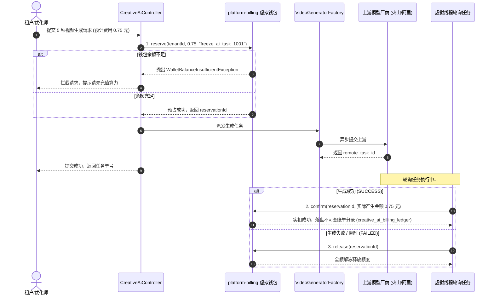

# 06 - AI 算力计量、计费分账与投产比 (ROI) 结算

## 1. 业务目标与计费定位

随着 AI 视频大模型与语音合成在日常广告生产中的常态化运行，各租户、事业部及外部客户每月会产生数万至数十万次视频生成请求。生成任务消耗的是真金白银的 GPU 算力成本（如火山引擎按每秒 0.15 元计费，阿里百炼按每秒 0.20 元计费）。

为防止算力被恶意刷爆并实现清晰的财务归因，系统构建了**算力计量与虚拟钱包分账闭环**：
1. **精确计量**：支持按有效生成时长（秒数）或 Token 量精确计量。
2. **两阶段资金管控**：深度对接平台已有的 `platform-billing` 模块，执行**提交前预占（Reserve）$\to$ 成功实扣（Confirm）$\to$ 失败回退（Release）**。
3. **部门分账与 AI 生产 ROI 核算**：精确计算各业务线在 AI 生产上投入的成本与最终投放产生的 GMV/收入比率。

---

## 2. 算力计费模型与两阶段资金管控



### 计费单价矩阵 (Pricing Matrix)
在 `creative_ai_model_meta` 表中配置各模型基准单价与计费单位：
- **`ark_seedance_2_0`**：`billing_unit = 'SECOND'`，基准单价 0.1500 元/秒（生成 5 秒视频扣减 0.75 元）。
- **`dashscope_wan_2_1`**：`billing_unit = 'SECOND'`，基准单价 0.2000 元/秒。
- **`doubao-seed-2-0-pro` (LLM/分镜)**：`billing_unit = 'TOKEN'`，基准单价 0.0020 元/千Token。
- **租户专属倍率 (`pricing_multiplier`)**：针对 VIP 租户或外部渠道客可配置浮动倍率（如 1.20 代表加收 20% 服务费）。

---

## 3. 生产级租户与部门内部分账 SQL

系统复用并升级了 `F:\works\media-hub` 中的原生模型分账脚本，可在 PostgreSQL 中直接按账期、租户与部门进行算力分账汇总：

```sql
-- =============================================================================
-- AI 视频原生模型算力分账与部门汇总报表
-- =============================================================================
SELECT
    t.tenant_id                                                         AS tenant_id,
    COALESCE(l.department_id, 'UNKNOWN_DEPT')                           AS department_id,
    SUM(CASE WHEN t.model_code LIKE 'ark_seedance%' THEN 1 ELSE 0 END)  AS seedance_task_count,
    SUM(CASE WHEN t.model_code LIKE 'happyhorse%' OR t.model_code LIKE 'dashscope_wan%' THEN 1 ELSE 0 END) AS dashscope_task_count,
    COUNT(1)                                                            AS total_task_count,
    SUM(CASE WHEN t.status IN ('SUCCESS', 'SUCCESS_FETCHED') THEN 1 ELSE 0 END) AS success_task_count,
    ROUND(COALESCE(SUM(CASE WHEN t.cost_status = 'CALCULATED' OR t.cost_status = 'SETTLED' THEN t.estimated_cost ELSE 0 END), 0), 4) AS total_cost_cny,
    ROUND(COALESCE(SUM(CASE WHEN t.model_code LIKE 'ark_seedance%' THEN t.estimated_cost ELSE 0 END), 0), 4) AS seedance_cost_cny,
    ROUND(COALESCE(SUM(CASE WHEN t.model_code LIKE 'dashscope_wan%' THEN t.estimated_cost ELSE 0 END), 0), 4) AS dashscope_cost_cny,
    ROUND(COALESCE(SUM(CASE WHEN t.usage_unit = 'SECOND' THEN t.usage_quantity ELSE 0 END), 0), 2) AS total_billable_seconds,
    ROUND(COALESCE(SUM(CASE WHEN t.usage_unit = 'TOKEN' THEN t.usage_quantity ELSE 0 END), 0), 2)  AS total_billable_tokens
FROM creative_ai_task_record t
LEFT JOIN creative_ai_billing_ledger l ON l.task_id = t.id
WHERE t.tenant_id = :tenant_id
  AND t.created_at >= :start_time
  AND t.created_at <= :end_time
GROUP BY t.tenant_id, l.department_id;
```

---

## 4. AI 生产投产比 (AI ROI) 核算公式

平台将素材打标数据与计费分录打通，计算每个 AI 项目的实际商业价值：

$$\text{AI ROI} = \frac{\text{归因广告收入 (Attributed Revenue)} - \text{AI 算力成本 (AI Cost)} - \text{投放买量消耗 (Ad Spend)}}{\text{AI 算力成本 (AI Cost)} + \text{投放买量消耗 (Ad Spend)}}$$

- **商业价值**：
  若某个 AI 批量衍生项目花费了 \$50 的 AI 算力成本生成了 20 组视频，最终跑出了 2 个 `STAR` 爆款素材，带来了 \$10,000 的广告收入与 \$4,000 的消耗，该项目的 AI 生产直接创造了极高的正向投产比，以此指导运营团队持续对爆款 Prompt 进行二次模型迭代。
