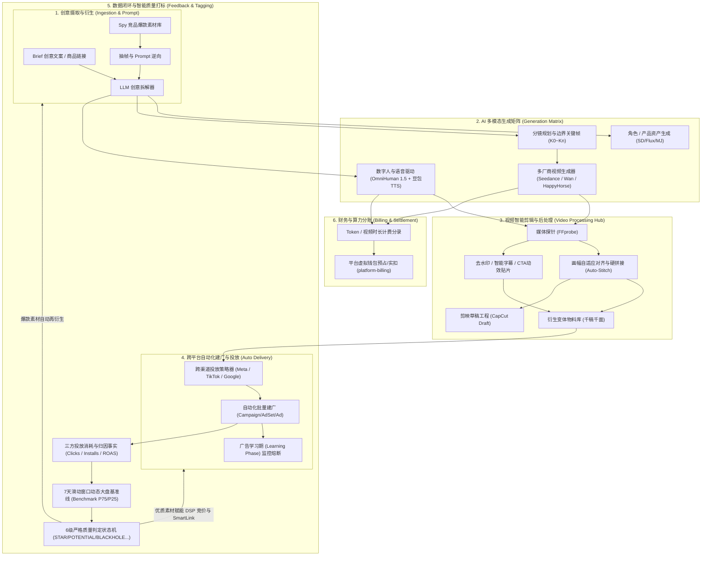

# Affiliate 素材自动化 (Creative Automation) 详细设计方案文档集

> 本文档集系统梳理并沉淀了面向程序化广告（RTB/DSP）与网盟效果营销（Affiliate Marketing）的工业级素材自动化生产、处理、打标与投放闭环设计方案。
> 参考基线：深度复用并演进项目在多模型接入、长视频工作台、画幅对齐拼接、动态基准线质量打标与跨媒体自动化投放等成熟实践。

---

## 📚 文档全景导航

| 序号 | 模块与专题 | 文档链接 | 核心设计要点 |
|---|---|---|---|
| **00** | **全局架构总纲** | [CREATIVE_AUTOMATION_SYSTEM_DESIGN.md](../CREATIVE_AUTOMATION_SYSTEM_DESIGN.md) | 全链路数据闭环全景、架构分层、12 张生产表 DDL 与全套 RESTful API 契约 |
| **01** | **AI 视频多模型引擎** | [01-AI_VIDEO_MULTI_MODEL_ENGINE.md](01-AI_VIDEO_MULTI_MODEL_ENGINE.md) | `Generator` + `Provider` + `ModelMeta` 三层解耦、动态表单驱动、异步生命周期与双重转存 |
| **02** | **AI 长视频工作台流水线** | [02-LONG_VIDEO_STUDIO_PIPELINE.md](02-LONG_VIDEO_STUDIO_PIPELINE.md) | 7 阶段工程流水线、6 套行业分镜 Prompt 管线、边界关键帧法 ($K_0 \sim K_n$)、数字人驱动与剪映草稿微秒级导出 |
| **03** | **视频智能剪辑与混剪中心** | [03-VIDEO_PROCESSING_AND_AUTO_STITCH.md](03-VIDEO_PROCESSING_AND_AUTO_STITCH.md) | 媒体探针 MediaProbe、画幅自适应硬拼接 (Auto-Stitch)、5 大原子算子、定时批量混剪与磁盘安全 |
| **04** | **素材效果打标与动态基准线** | [04-MATERIAL_QUALITY_TAGGING_AND_BENCHMARK.md](04-MATERIAL_QUALITY_TAGGING_AND_BENCHMARK.md) | 7 天滑动窗口大盘基准线 ETL SQL、三重有效样本保护门槛、6 级短路判定状态机与广告名称严格等值匹配 |
| **05** | **跨平台自动化建广与业务赋能** | [05-AD_AUTOMATION_AND_LEARNING_PHASE.md](05-AD_AUTOMATION_AND_LEARNING_PHASE.md) | Meta/TikTok 批量自动化建广、广告学习期监控与熔断、DSP 明星素材出价赋能与 SmartLink EPC 权重优化 |
| **06** | **AI 算力计量与财务分账** | [06-AI_BILLING_AND_SETTLEMENT.md](06-AI_BILLING_AND_SETTLEMENT.md) | 视频时长/Token 计量、对接 `platform-billing` 虚拟钱包预占/实扣、部门分账报表与 AI 投产比 (ROI) 核算 |
| **DDL**| **独立模块建表与索引脚本** | [16_platform_creative_automation.sql](../sql/16_platform_creative_automation.sql) | 12 张核心业务表 PostgreSQL 14+ 完整 DDL、外键约束与复合索引 |

---

## 🏗️ 架构拓扑全景

---

## 🛠️ 核心技术栈与规范

- **核心语言**：Java 21（全面采用 Virtual Threads 虚拟线程调度高 I/O 阻塞轮询任务）
- **核心框架**：Spring Boot 3.4.x、Spring Security、Flyway
- **数据库**：PostgreSQL 14+（行级多租户隔离 `tenant_id`、JSONB 半结构化存储、百分位窗口函数 `PERCENTILE_CONT`）
- **缓存与队列**：Redis 7.x（分布式令牌桶限流、任务去重锁）、Kafka（可靠事件驱动 Outbox 模式）
- **多媒体处理**：FFmpeg 6.x CLI、JavaCV (FFmpegFrameGrabber/Recorder)、Libass（字幕压制）、Delogo（去水印）
- **剪辑生态集成**：CapCut-Mate（剪映草稿生成 API）、字节跳动火山引擎（Seedance 2.0 / OmniHuman 1.5 / 豆包 TTS 2.0）、阿里百炼 DashScope（Wan 2.1 / HappyHorse）
